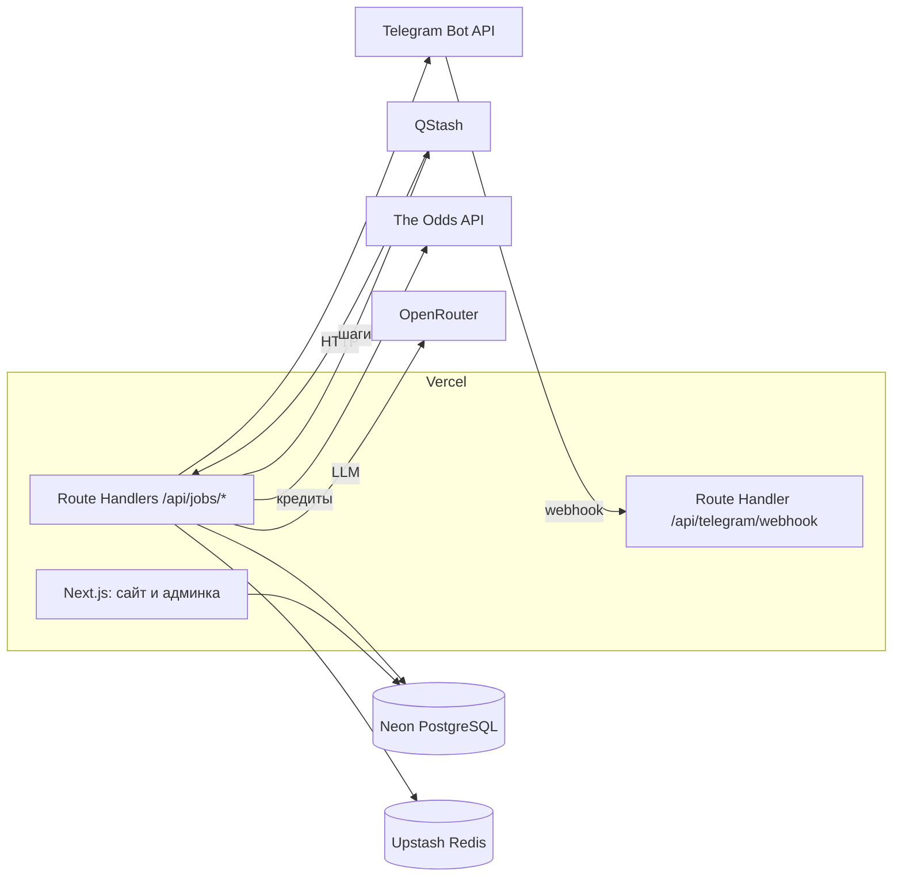

# Техническое задание: сервис AI-прогнозов на спортивные события

**Рабочее название:** BetInsight **Версия документа:** 1.5 **Дата:** 16.11.2026

## История версий

**1.5 (16.11.2026)** — логика отбора матчей переработана: введён пайплайн из 5 шагов (раздел 5.5), не зависящий от европейских коэффициентов. Добавлены таблицы `team_meta` и `rivalry_pairs`, расширена `model_evaluations`, обновлена `app_settings`.

**1.4** — публикуется только трек `ai_pick`. Трек `value` снят.

**1.3** — сброс публичной статистики.

**1.2** — трек `ai_pick`, учёт «почти-кандидатов», веб-поиск.

**1.1** — первая рабочая версия.

## 1. Цель и рамки проекта

**Цель:** проверить на реальных данных, способен ли AI-анализ спортивных событий давать прогнозы с положительным результатом. Для этого нужна полностью прозрачная статистика, которую нельзя подделать задним числом.

**Этап 1 (это ТЗ), бесплатный MVP:**

- получение расписания событий и коэффициентов из [The Odds API](https://the-odds-api.com/) на бесплатном тарифе (500 кредитов в месяц);
- отбор матчей по пайплайну из раздела 5.5, не зависящему от европейских коэффициентов;
- анализ и прогнозирование через LLM: OpenRouter с консенсусом нескольких моделей;
- публикация прогнозов на сайте и в Telegram до начала события;
- автоматический расчёт результатов после события;
- публичная честная статистика;
- Telegram-бот, который дублирует прогнозы и результаты;
- два языка интерфейса: русский и английский.

**Этап 2 (вне рамок, но архитектура должна его допускать):** платный доступ (подписка), закрытые прогнозы, оплата, личный кабинет.

**Чего нет в этапе 1:** приёма ставок, интеграции с букмекерами, платежей, мобильного приложения.

## 2. Технологический стек

| Слой | Технология |
| --- | --- |
| Язык | TypeScript (strict) |
| Веб-приложение | Next.js App Router |
| Хостинг | Vercel |
| Мультиязычность | next-intl (ru и en) |
| UI | Tailwind CSS, shadcn/ui, Recharts |
| База данных | PostgreSQL в Neon |
| ORM | Drizzle ORM |
| Планировщик | Upstash QStash |
| Кэш и блокировки | Upstash Redis |
| Telegram-бот | grammY (webhook) |
| Клиент LLM | @openrouter/sdk |
| Валидация | zod |
| Логи и ошибки | Sentry |
| Авторизация | Auth.js |
| CI/CD | GitHub + Vercel, GitHub Actions |
| Тесты | Vitest, Playwright |

### 2.1 Ограничения Vercel

1. Нет постоянно работающих процессов — фоновые задачи через Route Handlers, вызываются QStash.
2. Лимит времени функции 60–300 сек — длинные задачи разбиваются на шаги.
3. Vercel Cron на Hobby — не чаще раза в день, основной планировщик QStash.
4. Hobby — только некоммерческое использование, этап 2 требует Pro.
5. Подключения к БД из serverless — только pooled connection string Neon.

## 3. Архитектура

Главный принцип: **кредиты тратят только задачи из `/api/jobs/*`.** Действия пользователя никогда не приводят к запросу в The Odds API.



### 3.1 Компоненты

1. **Сайт** (`/[locale]/...`) — публичные страницы и админка. Внешние платные API не вызывает.
2. **Задачи** (`/api/jobs/*`) — все обращения к The Odds API и OpenRouter. Доступны только по подписанному запросу QStash или `Authorization: Bearer CRON_SECRET`.
3. **Telegram-бот** (`/api/telegram/webhook`) — webhook, проверяет `X-Telegram-Bot-Api-Secret-Token`.
4. **Neon PostgreSQL** — основное хранилище.
5. **Upstash Redis** — блокировки от параллельного запуска, rate limiting.

### 3.2 Структура репозитория

```
/src
  /app
    /[locale]/(public)      # главная, прогнозы, статистика, событие, методология
    /[locale]/admin         # админка
    /api/jobs               # sync-sports, sync-events, plan-day, fetch-odds,
                            # evaluate, ai-research, ai-vote, ai-consensus,
                            # publish, fetch-scores, settle, reports
    /api/telegram/webhook
    /api/health
  /server
    /db                     # схема Drizzle, миграции, репозитории
    /integrations
      /odds-api
      /openrouter
      /telegram
      /qstash
    /domain
      /odds                 # снятие маржи, консенсус
      /selection            # НОВЫЙ: пайплайн отбора матчей (раздел 5.5)
      /predictions
      /settlement
      /stats
    /budget
    /jobs
```

## 4. Интеграция с The Odds API

### 4.1 Роль коэффициентов в версии 1.5

Начиная с версии 1.5 коэффициенты из The Odds API **не используются** как критерий отбора матчей. API предоставляет данные европейских букмекеров (регион `eu`), тогда как целевой рынок проекта использует других букмекеров — сравнение теряет смысл.

Коэффициенты продолжают использоваться для:

- отображения на странице события (пользователь видит рыночный контекст);
- расчёта консенсус-вероятности как справочного показателя;
- расчёта CLV (если включено обновление перед стартом);
- бейзлайна «ставить на фаворита рынка» в статистике.

Отбор матчей для LLM ведётся через пайплайн раздела 5.5.

### 4.2 Стоимость эндпоинтов (v4)

| Эндпоинт | Стоимость | Назначение |
| --- | --- | --- |
| `GET /v4/sports` | бесплатно | список видов спорта и лиг |
| `GET /v4/sports/{sport}/events` | бесплатно | расписание событий |
| `GET /v4/sports/{sport}/odds` | кол-во рынков × кол-во регионов | коэффициенты по всей лиге |
| `GET /v4/sports/{sport}/scores` | 1 (с `daysFrom` — 2) | результаты |

### 4.3 Стратегия экономии кредитов

- Узкий охват: Ла Лига, Бундеслига, ЛЧ, Евролига, NBA, NHL и теннис (ATP/WTA). Регион `eu`, рынки `h2h`, `totals`, `spreads`. Каждый запрос `/odds` = 3 кредита.
- Расписание берётся бесплатно через `/events`.
- Один запрос `/odds` на лигу в игровой день, за 3–6 ч до первого матча.
- `/scores` вызывается только при наличии незакрытых событий.
- Повторное обновление перед стартом (для CLV) — только при остатке бюджета.
- Сырые ответы API сохраняются в БД (JSONB), не запрашиваются повторно.
- Защита от дублей: блокировка Redis + проверка `api_usage` перед запросом.

### 4.4 Модуль бюджета кредитов

- Месячный лимит: 500 кредитов, резерв 50 (10%) на результаты.
- Перед каждым платным запросом — проверка ожидаемой стоимости.
- Дневной лимит динамический: остаток / оставшиеся дни месяца.
- Приоритеты: 1) scores, 2) odds, 3) обновление перед стартом.
- Каждый вызов пишется в `api_usage`.

## 5. Анализ и прогнозирование

Публикуется **один трек** `ai_pick`. Математическая модель — предотбор и бейзлайн, отдельного трека Value нет.

### 5.1 Обзор пайплайна

Пайплайн состоит из двух независимых частей:

1. **Пайплайн отбора матчей** (раздел 5.5) — работает без коэффициентов, отбирает кандидатов по временно́му окну, значимости, форме и насыщенности данными.
2. **Пайплайн AI-голосования** (разделы 5.2–5.4) — получает кандидатов и публикует консенсусный прогноз.

### 5.2 Математическая модель (детерминированная, без затрат)

Модель не участвует в отборе матчей и не публикует прогнозы. Её единственная роль — извлечь из коэффициентов два справочных показателя.

**Консенсус-вероятность** (медиана «честных» вероятностей по всем букмекерам после снятия маржи) передаётся в промпт ai-vote как сигнал о том, как рынок оценивает матч. Если среди букмекеров есть Pinnacle — его вес выше.

**Бейзлайн «ставить на фаворита рынка»** считается по тем же данным и используется в публичной статистике для сравнения с результатами трека `ai_pick`. Без него хорошие цифры AI ничего не доказывают.

«Почти-кандидаты» (EV от 0 до порога) сохраняются с флагом `near_miss` для настройки порогов в админке.

### 5.3 Клиент LLM через OpenRouter

- Три модели разных провайдеров (`ai_pick_models`) + отдельная research-модель (`ai_pick_research_model`).
- Один запрос к LLM — одно событие, отдельным сообщением QStash.
- Вход: событие, лига, время, коэффициенты (справочно), консенсус-вероятности, сводка от research-модели.
- Выход: строго JSON по схеме с обоснованием на двух языках.

```json
{
  "probabilities": [
    { "market": "h2h", "selection": "home", "point": null, "p": 0.58 }
  ],
  "pick": { "market": "h2h", "selection": "home", "point": null },
  "confidence": "low|medium|high",
  "reasoning": { "ru": "до 600 символов", "en": "up to 600 characters" }
}
```

### 5.4 Трек `ai_pick`: консенсус нескольких LLM

**Шаг 1. Предотбор.** Для каждого события из пайплайна — 2–3 вероятных исхода из `h2h`, `totals`, `spreads`.

**Шаг 2. Независимое голосование.** Три модели, не видящие ответы друг друга. Research-модель готовит сводку (травмы, составы, форма, турнирная цена), которая добавляется в промпт всем голосующим.

**Шаг 3. Правило согласия.** Прогноз публикуется, если:

1. Не менее `ceil(M × 2/3)` моделей выбрали один исход.
2. Средняя AI-вероятность `p_ai ≥ 1/best_odds − 2%`.
3. Ни одна модель не поставила вероятность ниже 0.4.
4. Не более `daily_limit` прогнозов в день (по умолчанию 3).

**Шаг 4. Контрольные метрики:** сравнение с бейзлайном фаворита, доля совпадений с рынком, точность каждой модели отдельно.

### 5.5 Пайплайн отбора матчей (НОВЫЙ в версии 1.5)

Цель: выбрать из расписания матчи, по которым AI способна дать качественный прогноз, без зависимости от европейских коэффициентов.

```
Все события из расписания
  → [Шаг 1] Временно́е окно          → отсекаем слишком ранние и поздние
  → [Шаг 2] Значимость события       → significance_score (0–100)
  → [Шаг 3] Форма команд             → form_bonus (0–15)
  → [Шаг 4] Дневной лимит и квоты    → топ-N по final_score
  → [Шаг 5] Насыщенность (Perplexity) → data_score, отсев «пустых» матчей
  → ai-vote
```

#### Шаг 1 — Временно́е окно

Выполняется в `plan-day` (06:00 МСК). События вне окна не получают ни одного токена.

```
commence_time BETWEEN now() + window_min_hours AND now() + window_max_hours
```

По умолчанию: `window_min_hours = 20`, `window_max_hours = 54`. Оба параметра хранятся в `app_settings` и редактируются в админке.

#### Шаг 2 — Значимость события (`significance_score`, 0–100)

| Критерий | Баллы |
| --- | --- |
| Лига чемпионов УЕФА / NBA Finals / Финал НХЛ / Финал Евролиги | 40 |
| Ла Лига / Бундеслига / NBA / плей-офф NBA / НХЛ / плей-офф НХЛ / Евролига | 30 |
| Теннис Grand Slam | 35 |
| Теннис Masters 1000 / ATP 500 | 25 |
| Теннис ATP 250 / WTA | 15 |
| Финал турнира | +25 |
| Полуфинал | +20 |
| Четвертьфинал / 1/8 | +15 |
| Оба клуба в топ-4 лиги | +20 |
| Один клуб в топ-4 | +10 |
| Оба клуба в зоне вылета | +15 |
| Дерби (флаг `is_derby` из `rivalry_pairs`) | +15 |

Балл обрезается до 100. Позиции команд берутся из `team_meta` (обновляется вручную раз в неделю).

#### Шаг 3 — Форма команд (`form_bonus`, 0–15)

```typescript
const weights = [0.35, 0.25, 0.20, 0.12, 0.08]; // от новейшего к старому
const values  = { W: 1, D: 0.4, L: 0 };

function formScore(results: FormResult[]): number {
  return results.slice(0, 5)
    .reduce((sum, r, i) => sum + values[r] * weights[i], 0);
}

const formBonus = Math.round(
  Math.abs(formScore(homeResults) - formScore(awayResults)) * 15
);
```

Чем ярче асимметрия формы — тем интереснее матч. При менее 3 матчей у команды: `form_bonus = 0`, `form_source = 'insufficient_data'`.

`final_score = significance_score + form_bonus`

#### Шаг 4 — Дневной лимит и квоты

Из всех событий дня, прошедших шаги 1–3, берётся топ-N по `final_score`.

- `ai_pick_daily_limit`: максимум событий в день (по умолчанию 8).
- `daily_quotas.per_league`: не более 3 матчей из одной лиги.
- `daily_quotas.tennis`: не более 2 теннисных матчей.

#### Шаг 5 — Насыщенность данными (Perplexity/Sonar)

Только кандидаты из шага 4 идут на research. Расширяет задачу `ai-research`.

Prompt возвращает JSON:

```json
{
  "data_score": 7,
  "has_injuries": true,
  "has_lineup": false,
  "h2h_available": true,
  "summary": "Краткая сводка для ai-vote",
  "discard_reason": null
}
```

| `data_score` | Действие |
| --- | --- |
| ≥ 6 | Идёт на ai-vote, `summary` в промпт голосования |
| 4–5 | Идёт с флагом `low_confidence`, пометка в прогнозе |
| ≤ 3 | Отброшен, причина в `model_evaluations.discard_reason` |

## 6. Честная статистика

### 6.1 Правила неизменности

1. Прогноз публикуется **строго до** `commence_time`. Триггер в БД отклоняет вставку, если время ≥ старту.
2. После публикации прогноз нельзя редактировать или удалять. Запрет на уровне триггера БД.
3. Для каждого прогноза — `sha256` от канонического JSON. Хеш показывается на сайте.
4. Telegram-сообщение с прогнозом уходит в канал до начала матча.
5. Отменённые матчи — статус `void`, отображаются отдельно.
6. Выгрузка прогнозов текущей серии в CSV.

### 6.2 Метрики

- Hit rate, ROI, yield при ставке 1 единица.
- Кривая банка, максимальная просадка, серии.
- Brier score, график калибровки.
- Бейзлайны: «всегда на фаворита» и «только математическая модель».
- CLV (при включённом обновлении перед стартом).
- Дополнительно для `ai_pick`: точность каждой LLM, результаты «единогласно» vs «2 из 3», доля совпадений с фаворитом рынка.
- Виртуальная статистика «почти-кандидатов» и `no_consensus` — только в админке.

### 6.3 Сброс серии статистики

Кнопка **«Сбросить статистику»** в админке. Не удаляет прогнозы. В `app_settings.stats_epoch_started_at` записывается текущее время. Публичные метрики считают только записи с `published_at` не раньше этой отметки.

## 7. Мультиязычность (ru / en)

- Библиотека next-intl, маршруты `/ru/...` и `/en/...`.
- Язык по умолчанию — `en`. Выбор сохраняется в cookie.
- Все строки в `messages/ru.json` и `messages/en.json`. Захардкоженный текст запрещён, CI проверяет полноту.
- Даты, числа, проценты форматируются через `Intl` по локали.
- Обоснование AI генерируется и хранится на двух языках сразу.
- SEO: `hreflang`, локализованные `title` / `description`, `sitemap.xml`.

## 8. Telegram-бот

Все уведомления приходят автоматически. Бот работает в режиме webhook (`/api/telegram/webhook`).

Публичные каналы (ru и en): новый прогноз — матч, время, исход, уверенность, обоснование, ссылка; результат — ✅/❌/↩️ + обновлённые метрики; ежедневная и еженедельная сводки.

Команды бота: `/start`, `/today`, `/stats`, `/last`, `/settings`, `/lang`, `/stop`.

Админ-команды: `/budget`, `/health`, алерты об ошибках.

Технические детали: массовая рассылка пачками \~25 получателей с задержкой. Ошибка 403 = пользователь заблокировал бот, подписчик деактивируется.

## 9. Веб-интерфейс

Публичные страницы: главная (метрики, кривая банка, прогнозы), прогнозы (предстоящие + архив), страница события (коэффициенты справочно, прогноз, обоснование, хеш), статистика (метрики, графики, CSV), методология.

Админка: лиги, рынки, пороги; параметры пайплайна отбора (временно́е окно, лимиты, пороги `data_score`); таблицы `team_meta` и `rivalry_pairs`; модели OpenRouter и бюджет LLM; журнал задач; ручной расчёт исхода; сброс серии; тестовая страница `/admin/test` (цепочка Odds API → AI, только для администратора, не более 3 запусков в день).

**Cookie-баннер:** при первом посещении снизу выезжает панель с кнопкой «Принять» и кратким текстом о файлах cookie. Выбор сохраняется в `localStorage` под ключом `cookie_consent` со значением `accepted` или `declined`. Повторно баннер не показывается. Если пользователь отклонил — аналитика не подключается. Реализуется как клиентский компонент Next.js, отображается поверх всех страниц через корневой layout.

Требования: mobile-first, тёмная тема, ISR с `revalidateTag`.

## 10. Модель данных

### 10.1 Основные таблицы

| Таблица | Ключевые поля |
| --- | --- |
| `app_settings` | см. 10.2 |
| `sports` | key, group, title, active, enabled\_by\_admin |
| `events` | id, sport\_key, home, away, commence\_time, status, home\_score, away\_score, completed\_at |
| `odds_snapshots` | id, event\_id, fetched\_at, bookmaker, market, outcome, point, price, is\_closing |
| `model_evaluations` | см. 10.3 |
| `ai_votes` | id, event\_id, ai\_request\_id, model, market, selection, point, probabilities (JSONB), confidence |
| `ai_consensus` | event\_id, models, votes\_for, votes\_total, p\_ai\_mean, status, prediction\_id |
| `predictions` | id, track, event\_id, market, selection, point, price, bookmaker, model\_prob, ai\_prob, ev, confidence, reasoning\_ru, reasoning\_en, llm\_model, prompt\_version, status, profit\_units, published\_at, settled\_at, hash |
| `ai_requests` | id, event\_id, model, tokens\_in, tokens\_out, cost\_usd, latency\_ms, raw\_response, error, web\_search, sources, purpose |
| `api_usage` | id, endpoint, params, cost, remaining, used, source, created\_at |
| `job_runs` | id, job, idempotency\_key, status, started\_at, finished\_at, error, payload |
| `team_meta` | см. 10.4 |
| `rivalry_pairs` | см. 10.5 |
| `tg_subscribers` | telegram\_id, username, locale, active, leagues, quiet\_hours |
| `users` *(заготовка)* | id, email, telegram\_id, locale, role, subscription\_until |

### 10.2 Обновлённая `app_settings`

```sql
-- Существующие поля
llm_model                    TEXT,
ai_pick_models               JSONB,      -- массив из 3 идентификаторов
ai_pick_research_model       TEXT,
stats_epoch_started_at       TIMESTAMPTZ,

-- Новые поля (пайплайн отбора)
selection_window_min_hours   SMALLINT DEFAULT 20,
selection_window_max_hours   SMALLINT DEFAULT 54,
ai_pick_daily_limit          SMALLINT DEFAULT 8,
daily_quotas                 JSONB DEFAULT '{"per_league": 3, "tennis": 2}',
data_score_threshold         SMALLINT DEFAULT 6,
data_score_low_conf          SMALLINT DEFAULT 4,
llm_monthly_budget_usd       NUMERIC(8,2) DEFAULT 20.00
```

### 10.3 Обновлённая `model_evaluations`

```sql
-- Существующие поля
event_id, market, outcome, consensus_prob, best_price, best_bookmaker,
ev, is_candidate, near_miss, ai_pick_shortlisted,

-- Новые поля (пайплайн отбора)
significance_score    SMALLINT,       -- 0-100
form_home             NUMERIC(4,3),   -- 0.0-1.0
form_away             NUMERIC(4,3),
form_delta            NUMERIC(4,3),
form_bonus            SMALLINT,       -- 0-15
final_score           SMALLINT,       -- significance_score + form_bonus
data_score            SMALLINT,       -- 1-10, от Perplexity
research_summary      TEXT,
discard_reason        TEXT,
low_confidence        BOOLEAN DEFAULT FALSE,
form_source           TEXT            -- 'calculated' | 'insufficient_data'
```

### 10.4 Новая таблица `team_meta`

```sql
team_name     TEXT NOT NULL,
sport_key     TEXT NOT NULL,
league_key    TEXT NOT NULL,
table_rank    SMALLINT,
is_relegation BOOLEAN DEFAULT FALSE,
updated_at    TIMESTAMPTZ NOT NULL DEFAULT now(),
PRIMARY KEY (team_name, league_key)
```

Обновляется вручную в админке раз в неделю. На этапе 2 — автосинхронизация через football-data.org или api-sports.io.

### 10.5 Новая таблица `rivalry_pairs`

```sql
sport_key   TEXT NOT NULL,
team_a      TEXT NOT NULL,
team_b      TEXT NOT NULL,
label       TEXT,  -- 'El Clásico', 'Дерби Мадрида'
PRIMARY KEY (sport_key, team_a, team_b)
```

## 11. Фоновые задачи

Все задачи — Route Handlers `/api/jobs/<n>`, вызываются QStash. Время по МСК, хранится в UTC.

| Задача | Запуск | Кредиты |
| --- | --- | --- |
| `sync-sports` | раз в неделю | 0 |
| `sync-events` | каждые 6 часов | 0 |
| `plan-day` | 06:00 — строит план, запускает шаги 1–4 пайплайна отбора, ставит задачи `fetch-odds` и `ai-research` для кандидатов | 0 |
| `fetch-odds` | за 3–6 ч до первого матча лиги | 3 на лигу |
| `evaluate-model` | сразу после `fetch-odds` | 0 |
| `ai-research` | для каждого кандидата: Perplexity/Sonar, `data_score`, `summary` | 0 (OpenRouter) |
| `ai-vote` | после `ai-research` с `data_score ≥ 4`: по одному сообщению на пару «событие × модель» | 0 (OpenRouter) |
| `ai-consensus` | когда собраны все голоса (или по таймауту 10 мин) | 0 |
| `publish` | после прогноза: сброс кэша и рассылка в Telegram | 0 |
| `fetch-closing-odds` *(опционально)* | за 15–30 мин до старта | 3 на лигу |
| `fetch-scores` | через 3 ч после старта последнего матча + повтор для незакрытых | 2 на лигу |
| `settle` | сразу после `fetch-scores` | 0 |
| `daily-report` / `weekly-report` | 23:00 / понедельник 10:00 | 0 |
| `backup-db` | GitHub Actions, еженедельно | 0 |

### 11.1 Порядок выполнения

```
plan-day (06:00)
  → шаги 1–4: временно́е окно, значимость, форма, лимит
  → ставим fetch-odds (для активных лиг)
  → ставим ai-research (для каждого кандидата)

fetch-odds → evaluate-model  [параллельно]

ai-research (для каждого кандидата)
  → data_score ≥ 4 → ai-vote × 3 модели
  → data_score ≤ 3 → discard

ai-vote × 3 → ai-consensus → publish
```

Требования к каждой задаче: проверка подписи QStash, идемпотентность (`idempotency_key`), блокировка Redis, при ошибке — 5xx с ретраями QStash.

## 12. Нефункциональные требования

- Безопасность: все секреты в Environment Variables Vercel. Ключи не попадают в клиентский бандл. Rate limiting на публичные эндпоинты.
- Preview-окружения: задачи выключены или используют моки. Webhook Telegram и расписания QStash — только в Production.
- Надёжность: сбой внешнего API не ломает остальные задачи. Доступен `/api/health`, алерты в Telegram.
- Производительность: публичные страницы из кэша (ISR), TTFB < 500 мс.
- Качество: покрытие доменного слоя ≥ 80%. Юнит-тесты обязательны для снятия маржи, расчёта EV, расчёта исходов, метрик и пайплайна отбора (`significance_score`, `formScore`, `final_score`, пороги `data_score`).
- Юридическое: дисклеймер 18+. Коэффициенты на странице события отображаются без указания букмекера для ставки.

### 12.1 Ориентировочные расходы на этапе 1

| Сервис | Тариф | Стоимость |
| --- | --- | --- |
| Vercel | Hobby | $0 |
| Neon PostgreSQL | Free | $0 |
| Upstash QStash и Redis | Free | $0 |
| The Odds API | Free, 500 кредитов | $0 |
| OpenRouter `ai-research` | до 8 событий/день × Perplexity/Sonar | \~$1–2/мес |
| OpenRouter `ai-vote` | до 8 событий/день × 3 модели | \~$5–7/мес |
| Домен | — | \~$10–15/год |

## 13. Этапы работ и критерии приёмки

| Этап | Содержание | Критерий приёмки |
| --- | --- | --- |
| 0. Каркас | репозиторий, Vercel, Neon, Upstash, CI, домен, next-intl | сайт открывается на обоих языках, CI зелёный |
| 1. Данные | клиент Odds API, модуль бюджета, `sync-*`, `plan-day`, `fetch-odds`, `fetch-scores` | за неделю расход совпадает с планом, нет дублей |
| 2. Пайплайн отбора | `team_meta`, `rivalry_pairs`, `significance_score`, `formScore`, интеграция Perplexity | кандидаты видны в админке, тесты проходят |
| 3. Математическая модель | снятие маржи, консенсус, EV, тесты | кандидаты с `consensus_prob` и `ev` в админке |
| 4. AI | клиент OpenRouter, промпты, JSON-схема с ru/en, логирование | ≥ 95% ответов валидны, прогноз сохранён до старта |
| 5. Расчёт и статистика | settlement, метрики, бейзлайны, неизменность | ручная проверка 20 событий без расхождений |
| 6. Сайт | публичные страницы, админка, локализация | все страницы на мобильном и десктопе, ru и en |
| 7. Telegram | webhook, каналы, команды, рассылки, алерты | прогноз в канале до старта, результат после расчёта |
| 8. Обкатка | 4 недели без ручного вмешательства | бюджет не исчерпан, нет потерянных результатов |

---

## 14. Допущения

1. Виды спорта: футбол (Ла Лига, Бундеслига, ЛЧ), баскетбол (Евролига, NBA), хоккей (NHL), теннис (ATP/WTA).
2. Рынки: `h2h`, `totals`, `spreads`. Экспрессы не включены.
3. Регион коэффициентов: `eu` (для справочных данных и бейзлайна). Отбор матчей от коэффициентов не зависит.
4. Позиции команд в `team_meta` обновляются вручную (этап 1). Автосинхронизация — этап 2.
5. Хостинг: Vercel Hobby (этап 1), Pro (этап 2).
6. Telegram: два публичных канала (ru и en) + бот для личных сообщений.
7. Языки: русский и английский, английский по умолчанию.
8. Модели LLM: 3 модели разных провайдеров для `ai_pick`, отдельная research-модель (Perplexity/Sonar). Бюджет до $20/мес.
9. Аудитория этапа 2 определяется позже — влияет на платёжную систему и юридические требования.
