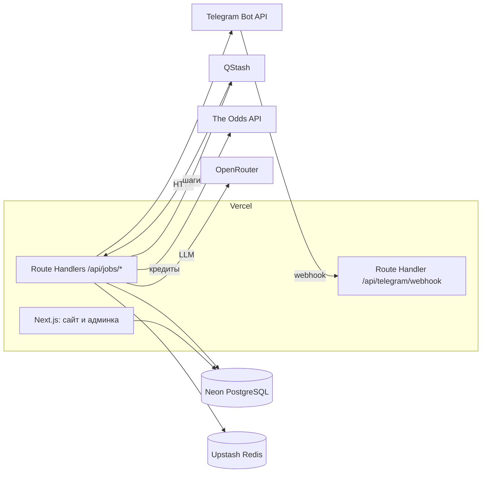

# Техническое задание: сервис AI-прогнозов на спортивные события

**Рабочее название:** BetInsight **Версия документа:** 1.11 **Дата:** 19.11.2026

## История версий

**1.11 (19.11.2026)** — `plan-day` перенесён с 06:00 на 07:00 МСК, чтобы отбор видел расписание, сохранённое в 06:00.

**1.10 (18.11.2026)** — убраны таблицы `team_meta` и `rivalry_pairs` и вкладка админки для них. Места команд и дерби не участвуют в отборе матчей.

**1.9 (18.11.2026)** — удалены все упоминания трека `value`: из истории версий, раздела 5, таблиц `predictions` и `model_evaluations`, `app_settings`, этапов работ, допущений и требований к тестам.

**1.8 (18.11.2026)** — полностью переработан раздел 5 (пайплайн отбора): убраны significance_score и form_bonus как критерии отбора; введён фильтр вероятностной асимметрии 60–70% по h2h/totals/spreads; квота топ-2 на лигу; окно публикации 08:00–20:00 МСК; временно́е окно изменено на 4–24 ч; форма команд перенесена в ai-research; обновлены таблица задач и порядок выполнения.

**1.7 (18.11.2026)** — зафиксирован источник данных о форме команд: лёгкий Perplexity/Sonar-запрос в рамках `plan-day` до Шага 4; обновлены таблица задач и порядок выполнения. На этапе 2 — автосинхронизация через football-data.org / api-sports.io.

**1.6 (18.11.2026)** — уточнена роль коэффициентов как вероятностного оракула: в разделах 5.2 и 5.4 прописан приоритет Pinnacle при предотборе исходов; при его отсутствии — консенсус по всем букмекерам после снятия маржи.

**1.5 (16.11.2026)** — логика отбора матчей переработана: введён пайплайн из 5 шагов (раздел 5.5), не зависящий от европейских коэффициентов. Добавлены таблицы `team_meta` и `rivalry_pairs`, расширена `model_evaluations`, обновлена `app_settings`.

**1.4** — сброс публичной статистики.

**1.3** — учёт «почти-кандидатов», веб-поиск.

**1.2** — первые прогнозы.

**1.1** — первая рабочая версия.

## 1. Цель и рамки проекта

**Цель:** проверить на реальных данных, способен ли AI-анализ спортивных событий давать прогнозы с положительным результатом. Для этого нужна полностью прозрачная статистика, которую нельзя подделать задним числом.

**Этап 1 (это ТЗ), бесплатный MVP:**

- получение расписания событий и коэффициентов из [The Odds API](https://the-odds-api.com/) на бесплатном тарифе (500 кредитов в месяц);
- отбор матчей по пайплайну из раздела 5 (фильтр асимметрии 60–70%, квота по лигам);
- анализ и прогнозирование через LLM: OpenRouter с консенсусом нескольких моделей;
- публикация прогнозов на сайте и в Telegram до начала события;
- автоматический расчёт результатов после события;
- публичная честная статистика;
- Telegram-бот, который дублирует прогнозы и результаты;
- два языка интерфейса: русский и английский.

**Этап 2 (вне рамок, но архитектура должна его допускать):** платный доступ (подписка), закрытые прогнозы, оплата, личный кабинет.

**Чего нет в этапе 1:** приёма ставок, интеграции с букмекерами, платежей, мобильного приложения.

## 2. Технологический стек

| Слой             | Технология                        |
| ---------------- | --------------------------------- |
| Язык             | TypeScript (strict)               |
| Веб-приложение   | Next.js App Router                |
| Хостинг          | Vercel                            |
| Мультиязычность  | next-intl (ru и en)               |
| UI               | Tailwind CSS, shadcn/ui, Recharts |
| База данных      | PostgreSQL в Neon                 |
| ORM              | Drizzle ORM                       |
| Планировщик      | Upstash QStash                    |
| Кэш и блокировки | Upstash Redis                     |
| Telegram-бот     | grammY (webhook)                  |
| Клиент LLM       | @openrouter/sdk                   |
| Валидация        | zod                               |
| Логи и ошибки    | Sentry                            |
| Авторизация      | Auth.js                           |
| CI/CD            | GitHub + Vercel, GitHub Actions   |
| Тесты            | Vitest, Playwright                |

### 2.1 Ограничения Vercel

1. Нет постоянно работающих процессов — фоновые задачи через Route Handlers, вызываются QStash.
2. Лимит времени функции 60–300 сек — длинные задачи разбиваются на шаги.
3. Vercel Cron на Hobby — не чаще раза в день, основной планировщик QStash.
4. Hobby — только некоммерческое использование, этап 2 требует Pro.
5. Подключения к БД из serverless — только pooled connection string Neon.

## 3. Архитектура

Главный принцип: **кредиты тратят только задачи из `/api/jobs/*`.** Действия пользователя никогда не приводят к запросу в The Odds API.



### 3.1 Компоненты

1. **Сайт** (`/[locale]/...`) — публичные страницы и админка. Внешние платные API не вызывает.
2. **Задачи** (`/api/jobs/*`) — все обращения к The Odds API и OpenRouter. Доступны только по подписанному запросу QStash или `Authorization: Bearer CRON_SECRET`.
3. **Telegram-бот** (`/api/telegram/webhook`) — webhook, проверяет `X-Telegram-Bot-Api-Secret-Token`.
4. **Neon PostgreSQL** — основное хранилище.
5. **Upstash Redis** — блокировки от параллельного запуска, rate limiting.

### 3.2 Структура репозитория

```
/src
  /app
    /[locale]/(public)      # главная, прогнозы, статистика, событие, методология
    /[locale]/admin         # админка
    /api/jobs               # sync-sports, sync-events, plan-day, fetch-odds,
                            # evaluate, ai-research, ai-vote, ai-consensus,
                            # publish, fetch-scores, settle, reports
    /api/telegram/webhook
    /api/health
  /server
    /db                     # схема Drizzle, миграции, репозитории
    /integrations
      /odds-api
      /openrouter
      /telegram
      /qstash
    /domain
      /odds                 # снятие маржи, консенсус
      /selection            # НОВЫЙ: пайплайн отбора матчей (раздел 5.5)
      /predictions
      /settlement
      /stats
    /budget
    /jobs
```

## 4. Интеграция с The Odds API

### 4.1 Роль коэффициентов в версии 1.5

Начиная с версии 1.5 коэффициенты из The Odds API **не используются** как критерий отбора матчей. API предоставляет данные европейских букмекеров (регион `eu`), тогда как целевой рынок проекта использует других букмекеров — сравнение теряет смысл.

Коэффициенты продолжают использоваться для:

- отображения на странице события (пользователь видит рыночный контекст);
- расчёта консенсус-вероятности как справочного показателя;
- расчёта CLV (если включено обновление перед стартом);
- бейзлайна «ставить на фаворита рынка» в статистике.

Отбор матчей для LLM ведётся через пайплайн раздела 5.5.

### 4.2 Стоимость эндпоинтов (v4)

| Эндпоинт                        | Стоимость                       | Назначение                |
| ------------------------------- | ------------------------------- | ------------------------- |
| `GET /v4/sports`                | бесплатно                       | список видов спорта и лиг |
| `GET /v4/sports/{sport}/events` | бесплатно                       | расписание событий        |
| `GET /v4/sports/{sport}/odds`   | кол-во рынков × кол-во регионов | коэффициенты по всей лиге |
| `GET /v4/sports/{sport}/scores` | 1 (с `daysFrom` — 2)            | результаты                |

### 4.3 Стратегия экономии кредитов

- Узкий охват: Ла Лига, Бундеслига, ЛЧ, Евролига, NBA, NHL и теннис (ATP/WTA). Регион `eu`, рынки `h2h`, `totals`, `spreads`. Каждый запрос `/odds` = 3 кредита.
- Расписание берётся бесплатно через `/events`.
- Один запрос `/odds` на лигу в игровой день, за 3–6 ч до первого матча.
- `/scores` вызывается только при наличии незакрытых событий.
- Повторное обновление перед стартом (для CLV) — только при остатке бюджета.
- Сырые ответы API сохраняются в БД (JSONB), не запрашиваются повторно.
- Защита от дублей: блокировка Redis + проверка `api_usage` перед запросом.

### 4.4 Модуль бюджета кредитов

- Месячный лимит: 500 кредитов, резерв 50 (10%) на результаты.
- Перед каждым платным запросом — проверка ожидаемой стоимости.
- Дневной лимит динамический: остаток / оставшиеся дни месяца.
- Приоритеты: 1) scores, 2) odds, 3) обновление перед стартом.
- Каждый вызов пишется в `api_usage`.

## 5. Анализ и прогнозирование

Публикуется трек `ai_pick`. Математическая модель используется как вероятностный оракул и бейзлайн для сравнения.

### 5.1 Обзор пайплайна

Пайплайн состоит из двух частей:

1. **Отбор матчей** (раздел 5.5) — ежедневно в 07:00: получение коэффициентов, фильтр асимметрии 60–70%, квота топ-2 на лигу, планирование голосования.
2. **AI-голосование** (разделы 5.2–5.4) — запускается по расписанию за 2 часа до матча: research, консенсус трёх моделей, публикация.

### 5.2 Математическая модель (детерминированная, без затрат)

Модель не участвует в отборе матчей и не публикует прогнозы. Её единственная роль — извлечь из коэффициентов два справочных показателя.

**Консенсус-вероятность** считается как медиана «честных» вероятностей по всем доступным букмекерам после снятия маржи. Если в снэпшоте присутствует Pinnacle — его вероятности берутся с повышенным весом как наиболее sharp источник. Консенсус передаётся в промпт `ai-vote` как справочный сигнал о рыночной оценке матча.

**Бейзлайн «ставить на фаворита рынка»** считается по тем же данным и используется в публичной статистике для сравнения с результатами трека `ai_pick`. Без него хорошие цифры AI ничего не доказывают.

### 5.3 Клиент LLM через OpenRouter

- Три модели разных провайдеров (`ai_pick_models`) + отдельная research-модель (`ai_pick_research_model`).
- Один запрос к LLM — одно событие, отдельным сообщением QStash.
- Вход: событие, лига, время, коэффициенты (справочно), консенсус-вероятности, сводка от research-модели.
- Выход: строго JSON по схеме с обоснованием на двух языках.

```json
{
  "probabilities": [{ "market": "h2h", "selection": "home", "point": null, "p": 0.58 }],
  "pick": { "market": "h2h", "selection": "home", "point": null },
  "confidence": "low|medium|high",
  "reasoning": { "ru": "до 600 символов", "en": "up to 600 characters" }
}
```

### 5.4 Трек `ai_pick`: консенсус нескольких LLM

**Шаг 1. Предотбор исходов.** Для каждого события из пайплайна определяются 2–3 наиболее вероятных исхода по рынкам `h2h`, `totals`, `spreads`. Вероятности берутся из консенсуса после снятия маржи по следующему приоритету:

1. Если в снэпшоте есть **Pinnacle** — используются его вероятности как основа предотбора.
2. Если Pinnacle отсутствует — используется **консенсус по всем доступным букмекерам** после снятия маржи.

Коэффициенты используются исключительно как вероятностный оракул для выбора исходов — не как ориентир для ставок и не как сравнительная база с целевым рынком пользователей.

**Шаг 2. Независимое голосование.** Три модели, не видящие ответы друг друга. Research-модель готовит сводку (травмы, составы, форма, турнирная цена), которая добавляется в промпт всем голосующим.

**Шаг 3. Правило согласия.** Прогноз публикуется, если:

1. Не менее `ceil(M × 2/3)` моделей выбрали один исход.
2. Средняя AI-вероятность `p_ai ≥ 1/best_odds − 2%`.
3. Ни одна модель не поставила вероятность ниже 0.4.
4. Не более `daily_limit` прогнозов в день (по умолчанию 3).

**Шаг 4. Контрольные метрики:** сравнение с бейзлайном фаворита, доля совпадений с рынком, точность каждой модели отдельно.

### 5.5 Пайплайн отбора матчей (НОВЫЙ в версии 1.5)

Цель: ежедневно отбирать матчи с интересной вероятностной асимметрией и отправлять их на голосование моделям в правильное время.

```
07:00 — plan-day
  → [Шаг 1] Временно́е окно + fetch-odds   → матчи на 4–24 часа вперёд с коэффициентами
  → [Шаг 2] Фильтр асимметрии             → максимальный исход 50–70% по h2h/totals/spreads
  → [Шаг 3] Квота на лигу                 → топ-2 по силе асимметрии из каждой активной лиги
  → [Шаг 4] Планирование голосования      → задача ai-research+vote за 2 ч до матча (окно 08:00–20:00)

ai-research → ai-vote × 3 → ai-consensus → publish
```

#### Шаг 1 — Временно́е окно и получение коэффициентов

Выполняется в `plan-day` (07:00 МСК), после обновления расписания в 06:00. Запрашиваются коэффициенты через The Odds API для всех активных лиг (управляются администратором в админке). Берутся только матчи в окне:

```
commence_time BETWEEN now() + 4h AND now() + 24h
```

То есть в 07:00 это матчи с ~11:00 сегодня до ~07:00 завтра. Параметры `window_min_hours = 4` и `window_max_hours = 24` хранятся в `app_settings` и редактируются в админке.

Сырой снэпшот коэффициентов сохраняется в `odds_snapshots`. Повторный запрос для тех же событий не делается.

#### Шаг 2 — Фильтр вероятностной асимметрии

Для каждого матча из окна по рынкам `h2h`, `totals`, `spreads` снимается маржа и считается консенсус-вероятность:

- Если в снэпшоте есть **Pinnacle** — его вероятности берутся с повышенным весом.
- Если Pinnacle отсутствует — медиана по всем доступным букмекерам после снятия маржи.

Матч проходит фильтр если **максимальная вероятность любого исхода по любому из рынков находится в диапазоне 60–70%**:

```
max(p_h2h ∪ p_totals ∪ p_spreads) BETWEEN 0.60 AND 0.70
```

Примеры:

- Победа хозяев 62%, ничья 22%, победа гостей 16% → ✅ 62% попадает в диапазон
- Тотал больше 2.5 с вероятностью 68% → ✅
- Фаворит с вероятностью 78% → ❌ слишком очевидно
- Максимальный исход 54% → ❌ слишком неопределённо

Граница диапазона (`prob_min = 0.60`, `prob_max = 0.70`) хранится в `app_settings` и редактируется в админке.

#### Шаг 3 — Квота на лигу

Из матчей, прошедших Шаг 2, берётся **топ-2 по силе асимметрии** из каждой активной лиги. Сила асимметрии = насколько максимальный исход близок к центру диапазона (65%). Матч с вероятностью 64% предпочтительнее матча с 69%.

```typescript
const asymmetryScore = (p: number) => 1 - Math.abs(p - 0.65) / 0.05;
```

Список активных лиг управляется администратором в админке (`sports.enabled_by_admin`). Администратор ежедневно оставляет 2–3 нужные лиги активными.

#### Шаг 4 — Планирование голосования

Для каждого кандидата из Шага 3 рассчитывается время отправки на голосование:

```
vote_time = max(commence_time − 2h, 20:00 МСК предыдущего дня)
```

**Правила:**

- Голосование запускается за 2 часа до начала матча.
- Если расчётное время попадает в окно **08:00–20:00 МСК** — используется как есть.
- Если матч начинается после 22:00 или на следующий день — голосование всё равно отправляется в **20:00 МСК** текущего дня. Ни один матч не пропускается.

Примеры:
| Начало матча | Расчётное время | Итоговое vote_time |
|---|---|---|
| 17:00 | 15:00 | 15:00 ✅ |
| 21:00 | 19:00 | 19:00 ✅ |
| 23:00 | 21:00 → за окном | 20:00 |
| 03:00 след. дня | 01:00 → за окном | 20:00 |

`plan-day` ставит задачу `ai-research` в QStash с `not_before = vote_time`.

#### Шаг 5 — Насыщенность данными (Perplexity/Sonar)

Запускается по расписанию из Шага 4 (`ai-research`). Perplexity ищет актуальную информацию по матчу: травмы, составы, форма, турнирная мотивация, история личных встреч.

Промпт возвращает JSON:

```json
{
  "data_score": 7,
  "has_injuries": true,
  "has_lineup": false,
  "h2h_available": true,
  "home_form": ["W", "W", "L", "D", "W"],
  "away_form": ["L", "W", "W", "L", "L"],
  "summary": "Краткая сводка для ai-vote",
  "discard_reason": null
}
```

| `data_score` | Действие                                               |
| ------------ | ------------------------------------------------------ |
| ≥ 6          | Идёт на ai-vote, `summary` в промпт голосования        |
| 4–5          | Идёт с флагом `low_confidence`, пометка в прогнозе     |
| ≤ 3          | Отброшен, причина в `model_evaluations.discard_reason` |

## 6. Честная статистика

### 6.1 Правила неизменности

1. Прогноз публикуется **строго до** `commence_time`. Триггер в БД отклоняет вставку, если время ≥ старту.
2. После публикации прогноз нельзя редактировать или удалять. Запрет на уровне триггера БД.
3. Для каждого прогноза — `sha256` от канонического JSON. Хеш показывается на сайте.
4. Telegram-сообщение с прогнозом уходит в канал до начала матча.
5. Отменённые матчи — статус `void`, отображаются отдельно.
6. Выгрузка прогнозов текущей серии в CSV.

### 6.2 Метрики

- Hit rate, ROI, yield при ставке 1 единица.
- Кривая банка, максимальная просадка, серии.
- Brier score, график калибровки.
- Бейзлайны: «всегда на фаворита» и «только математическая модель».
- CLV (при включённом обновлении перед стартом).
- Дополнительно для `ai_pick`: точность каждой LLM, результаты «единогласно» vs «2 из 3», доля совпадений с фаворитом рынка.
- Виртуальная статистика `no_consensus` — только в админке.

### 6.3 Сброс серии статистики

Кнопка **«Сбросить статистику»** в админке. Не удаляет прогнозы. В `app_settings.stats_epoch_started_at` записывается текущее время. Публичные метрики считают только записи с `published_at` не раньше этой отметки.

## 7. Мультиязычность (ru / en)

- Библиотека next-intl, маршруты `/ru/...` и `/en/...`.
- Язык по умолчанию — `en`. Выбор сохраняется в cookie.
- Все строки в `messages/ru.json` и `messages/en.json`. Захардкоженный текст запрещён, CI проверяет полноту.
- Даты, числа, проценты форматируются через `Intl` по локали.
- Обоснование AI генерируется и хранится на двух языках сразу.
- SEO: `hreflang`, локализованные `title` / `description`, `sitemap.xml`.

## 8. Telegram-бот

Все уведомления приходят автоматически. Бот работает в режиме webhook (`/api/telegram/webhook`).

Публичные каналы (ru и en): новый прогноз — матч, время, исход, уверенность, обоснование, ссылка; результат — ✅/❌/↩️ + обновлённые метрики; ежедневная и еженедельная сводки.

Команды бота: `/start`, `/today`, `/stats`, `/last`, `/settings`, `/lang`, `/stop`.

Админ-команды: `/budget`, `/health`, алерты об ошибках.

Технические детали: массовая рассылка пачками \~25 получателей с задержкой. Ошибка 403 = пользователь заблокировал бот, подписчик деактивируется.

## 9. Веб-интерфейс

Публичные страницы: главная (метрики, кривая банка, прогнозы), прогнозы (предстоящие + архив), страница события (коэффициенты справочно, прогноз, обоснование, хеш), статистика (метрики, графики, CSV), методология.

Админка: лиги, рынки, пороги; параметры пайплайна отбора (временно́е окно, лимиты, пороги `data_score`); модели OpenRouter и бюджет LLM; журнал задач; ручной расчёт исхода; сброс серии; тестовая страница `/admin/test` (цепочка Odds API → AI, только для администратора, не более 3 запусков в день).

**Cookie-баннер:** при первом посещении снизу выезжает панель с кнопкой «Принять» и кратким текстом о файлах cookie. Выбор сохраняется в `localStorage` под ключом `cookie_consent` со значением `accepted` или `declined`. Повторно баннер не показывается. Если пользователь отклонил — аналитика не подключается. Реализуется как клиентский компонент Next.js, отображается поверх всех страниц через корневой layout.

Требования: mobile-first, тёмная тема, ISR с `revalidateTag`.

## 10. Модель данных

### 10.1 Основные таблицы

| Таблица               | Ключевые поля                                                                                                                                                                              |
| --------------------- | ------------------------------------------------------------------------------------------------------------------------------------------------------------------------------------------ |
| `app_settings`        | см. 10.2                                                                                                                                                                                   |
| `sports`              | key, group, title, active, enabled_by_admin                                                                                                                                                |
| `events`              | id, sport_key, home, away, commence_time, status, home_score, away_score, completed_at                                                                                                     |
| `odds_snapshots`      | id, event_id, fetched_at, bookmaker, market, outcome, point, price, is_closing                                                                                                             |
| `model_evaluations`   | см. 10.3                                                                                                                                                                                   |
| `ai_votes`            | id, event_id, ai_request_id, model, market, selection, point, probabilities (JSONB), confidence                                                                                            |
| `ai_consensus`        | event_id, models, votes_for, votes_total, p_ai_mean, status, prediction_id                                                                                                                 |
| `predictions`         | id, event_id, market, selection, point, price, bookmaker, ai_prob, confidence, reasoning_ru, reasoning_en, llm_model, prompt_version, status, profit_units, published_at, settled_at, hash |
| `ai_requests`         | id, event_id, model, tokens_in, tokens_out, cost_usd, latency_ms, raw_response, error, web_search, sources, purpose                                                                        |
| `api_usage`           | id, endpoint, params, cost, remaining, used, source, created_at                                                                                                                            |
| `job_runs`            | id, job, idempotency_key, status, started_at, finished_at, error, payload                                                                                                                  |
| `tg_subscribers`      | telegram_id, username, locale, active, leagues, quiet_hours                                                                                                                                |
| `users` _(заготовка)_ | id, email, telegram_id, locale, role, subscription_until                                                                                                                                   |

### 10.2 Обновлённая `app_settings`

```sql
-- Существующие поля
llm_model                    TEXT,
ai_pick_models               JSONB,      -- массив из 3 идентификаторов
ai_pick_research_model       TEXT,
stats_epoch_started_at       TIMESTAMPTZ,

-- Новые поля (пайплайн отбора)
selection_window_min_hours   SMALLINT DEFAULT 4,
selection_window_max_hours   SMALLINT DEFAULT 24,
prob_min                     NUMERIC(4,3) DEFAULT 0.60,
prob_max                     NUMERIC(4,3) DEFAULT 0.70,
league_quota                 SMALLINT DEFAULT 2,
vote_window_start            SMALLINT DEFAULT 8,   -- час МСК
vote_window_end              SMALLINT DEFAULT 20,  -- час МСК
data_score_threshold         SMALLINT DEFAULT 6,
data_score_low_conf          SMALLINT DEFAULT 4,
llm_monthly_budget_usd       NUMERIC(8,2) DEFAULT 20.00
```

### 10.3 Обновлённая `model_evaluations`

```sql
-- Существующие поля
event_id, market, outcome, consensus_prob, best_price, best_bookmaker,
is_candidate, ai_pick_shortlisted,

-- Новые поля (пайплайн отбора)
asymmetry_score       NUMERIC(4,3),   -- вероятность максимального исхода (0.60–0.70)
asymmetry_market      TEXT,           -- рынок с максимальной асимметрией
data_score            SMALLINT,       -- 1-10, от Perplexity
research_summary      TEXT,
discard_reason        TEXT,
low_confidence        BOOLEAN DEFAULT FALSE
```

## 11. Фоновые задачи

Все задачи — Route Handlers `/api/jobs/<n>`, вызываются QStash. Время по МСК, хранится в UTC.

| Задача                               | Запуск                                                                                                                                                                                       | Кредиты                          |
| ------------------------------------ | -------------------------------------------------------------------------------------------------------------------------------------------------------------------------------------------- | -------------------------------- |
| `sync-sports`                        | раз в неделю                                                                                                                                                                                 | 0                                |
| `sync-events`                        | каждые 6 часов                                                                                                                                                                               | 0                                |
| `plan-day`                           | 07:00 — запрашивает коэффициенты, применяет шаги 1–4 (временно́е окно, фильтр асимметрии, квота на лигу, планирование голосования), ставит задачи `ai-research` в QStash с нужным `vote_time` | 3 на лигу (The Odds API)         |
| `ai-research`                        | запускается по расписанию из `plan-day`: Perplexity/Sonar, `data_score`, `summary`, форма команд                                                                                             | ~$0.01–0.03 на матч (OpenRouter) |
| `ai-vote`                            | после `ai-research` с `data_score ≥ 4`: по одному сообщению на пару «событие × модель»                                                                                                       | 0 (OpenRouter)                   |
| `ai-consensus`                       | когда собраны все голоса (или по таймауту 10 мин)                                                                                                                                            | 0                                |
| `publish`                            | после прогноза: сброс кэша и рассылка в Telegram                                                                                                                                             | 0                                |
| `fetch-closing-odds` _(опционально)_ | за 15–30 мин до старта                                                                                                                                                                       | 3 на лигу                        |
| `fetch-scores`                       | через 3 ч после старта последнего матча + повтор для незакрытых                                                                                                                              | 2 на лигу                        |
| `settle`                             | сразу после `fetch-scores`                                                                                                                                                                   | 0                                |
| `daily-report` / `weekly-report`     | 23:00 / понедельник 10:00                                                                                                                                                                    | 0                                |
| `backup-db`                          | GitHub Actions, еженедельно                                                                                                                                                                  | 0                                |

### 11.1 Порядок выполнения

```
plan-day (07:00)
  → шаг 1: fetch-odds для активных лиг → временно́е окно 4–24 ч → odds_snapshots
  → шаг 2: снятие маржи (Pinnacle приоритет) → фильтр асимметрии 60–70%
  → шаг 3: топ-2 по асимметрии из каждой активной лиги → список кандидатов
  → шаг 4: расчёт vote_time (за 2 ч до матча, окно 08:00–20:00) → QStash задачи

[по расписанию vote_time для каждого матча]
ai-research (Perplexity: data_score, summary, форма)
  → data_score ≥ 4 → ai-vote × 3 модели
  → data_score ≤ 3 → discard

ai-vote × 3 → ai-consensus → publish → Telegram
```

Требования к каждой задаче: проверка подписи QStash, идемпотентность (`idempotency_key`), блокировка Redis, при ошибке — 5xx с ретраями QStash.

## 12. Нефункциональные требования

- Безопасность: все секреты в Environment Variables Vercel. Ключи не попадают в клиентский бандл. Rate limiting на публичные эндпоинты.
- Preview-окружения: задачи выключены или используют моки. Webhook Telegram и расписания QStash — только в Production.
- Надёжность: сбой внешнего API не ломает остальные задачи. Доступен `/api/health`, алерты в Telegram.
- Производительность: публичные страницы из кэша (ISR), TTFB < 500 мс.
- Качество: покрытие доменного слоя ≥ 80%. Юнит-тесты обязательны для снятия маржи, расчёта консенсус-вероятности, фильтра асимметрии, расчёта `vote_time`, метрик и порогов `data_score`.
- Юридическое: дисклеймер 18+. Коэффициенты на странице события отображаются без указания букмекера для ставки.

### 12.1 Ориентировочные расходы на этапе 1

| Сервис                   | Тариф                                | Стоимость    |
| ------------------------ | ------------------------------------ | ------------ |
| Vercel                   | Hobby                                | $0           |
| Neon PostgreSQL          | Free                                 | $0           |
| Upstash QStash и Redis   | Free                                 | $0           |
| The Odds API             | Free, 500 кредитов                   | $0           |
| OpenRouter `ai-research` | до 8 событий/день × Perplexity/Sonar | \~$1–2/мес   |
| OpenRouter `ai-vote`     | до 8 событий/день × 3 модели         | \~$5–7/мес   |
| Домен                    | —                                    | \~$10–15/год |

## 13. Этапы работ и критерии приёмки

| Этап                     | Содержание                                                                          | Критерий приёмки                                    |
| ------------------------ | ----------------------------------------------------------------------------------- | --------------------------------------------------- |
| 0. Каркас                | репозиторий, Vercel, Neon, Upstash, CI, домен, next-intl                            | сайт открывается на обоих языках, CI зелёный        |
| 1. Данные                | клиент Odds API, модуль бюджета, `sync-*`, `plan-day`, `fetch-odds`, `fetch-scores` | за неделю расход совпадает с планом, нет дублей     |
| 2. Пайплайн отбора       | фильтр асимметрии, квота на лигу, расчёт `vote_time`, интеграция Perplexity         | кандидаты видны в админке, тесты проходят           |
| 3. Математическая модель | снятие маржи, консенсус-вероятность, бейзлайн, тесты                                | кандидаты с `consensus_prob` в админке              |
| 4. AI                    | клиент OpenRouter, промпты, JSON-схема с ru/en, логирование                         | ≥ 95% ответов валидны, прогноз сохранён до старта   |
| 5. Расчёт и статистика   | settlement, метрики, бейзлайны, неизменность                                        | ручная проверка 20 событий без расхождений          |
| 6. Сайт                  | публичные страницы, админка, локализация                                            | все страницы на мобильном и десктопе, ru и en       |
| 7. Telegram              | webhook, каналы, команды, рассылки, алерты                                          | прогноз в канале до старта, результат после расчёта |
| 8. Обкатка               | 4 недели без ручного вмешательства                                                  | бюджет не исчерпан, нет потерянных результатов      |

---

## 14. Допущения

1. Виды спорта: футбол (Ла Лига, Бундеслига, ЛЧ), баскетбол (Евролига, NBA), хоккей (NHL), теннис (ATP/WTA).
2. Рынки: `h2h`, `totals`, `spreads`. Экспрессы не включены.
3. Регион коэффициентов: `eu` (используются как вероятностный оракул для фильтра асимметрии и бейзлайна, не как ориентир для ставок).
4. Хостинг: Vercel Hobby (этап 1), Pro (этап 2).
5. Telegram: два публичных канала (ru и en) + бот для личных сообщений.
6. Языки: русский и английский, английский по умолчанию.
7. Модели LLM: 3 модели разных провайдеров для `ai_pick`, отдельная research-модель (Perplexity/Sonar). Бюджет до $20/мес.
8. Аудитория этапа 2 определяется позже — влияет на платёжную систему и юридические требования.
