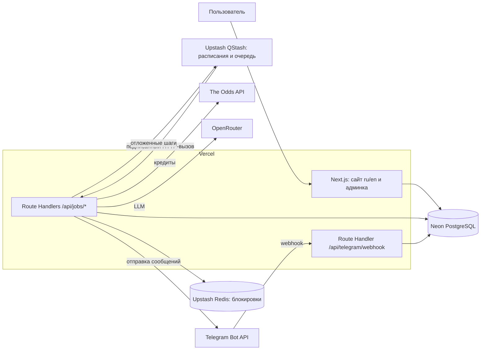

# Техническое задание: сервис AI-прогнозов на спортивные события

**Рабочее название:** BetInsight
**Версия документа:** 1.3
**Дата:** 06.11.2026

**Изменения в 1.3:** сброс публичной статистики из админки (раздел 6.3). Прогнозы не удаляются: начинается новая серия, старые строки из публичных метрик выпадают.

**Изменения в 1.2:** добавлен второй трек прогнозов «AI-пик» с консенсусом нескольких LLM (раздел 5.4), раздельная статистика по трекам, учёт «почти-кандидатов», веб-поиск для финальных кандидатов. Причина: за 3 дня тестирования строгая value-модель не дала ни одного прогноза.

---

## 1. Цель и рамки проекта

**Цель:** проверить на реальных данных, способен ли AI-анализ букмекерских коэффициентов давать прогнозы с положительным результатом. Для этого нужна полностью прозрачная статистика, которую нельзя подделать задним числом.

**Этап 1 (это ТЗ), бесплатный MVP:**
- получение коэффициентов из [The Odds API](https://the-odds-api.com/) на бесплатном тарифе (500 кредитов в месяц);
- анализ коэффициентов: сначала математическая модель, затем LLM через [OpenRouter](https://openrouter.ai/);
- публикация прогнозов на сайте и в Telegram до начала события;
- автоматический расчёт результатов после события;
- публичная честная статистика;
- Telegram-бот, который дублирует прогнозы и результаты;
- два языка интерфейса: русский и английский.

**Этап 2 (вне рамок, но архитектура должна его допускать):** платный доступ (подписка), закрытые прогнозы, оплата, личный кабинет.

**Чего нет в этапе 1:** приёма ставок, интеграции с букмекерами, платежей, мобильного приложения.

---

## 2. Технологический стек

| Слой | Технология |
|---|---|
| Язык | TypeScript (strict) |
| Веб-приложение | Next.js (актуальная стабильная версия, App Router, Server Components, Route Handlers) |
| Хостинг | Vercel |
| Мультиязычность | next-intl (локали `ru` и `en`, префикс в URL) |
| UI | Tailwind CSS и shadcn/ui, графики на Recharts |
| База данных | PostgreSQL в Neon (подключается через Vercel Marketplace) |
| ORM и миграции | Drizzle ORM и драйвер `@neondatabase/serverless` |
| Планировщик и очередь | Upstash QStash: расписания, отложенные сообщения, ретраи. Vercel Cron как резервный вариант для ежедневных задач |
| Кэш и блокировки | Upstash Redis (распределённые блокировки задач, rate limiting) |
| Telegram-бот | grammY в режиме webhook (Route Handler на Vercel) |
| Клиент LLM | официальный SDK `@openrouter/sdk` (версия фиксируется точно) |
| Валидация | zod (все ответы внешних API и ответы LLM) |
| HTTP-клиент | нативный `fetch` с ретраями и таймаутами |
| Логи и ошибки | Sentry, логи Vercel (опционально Axiom для долгого хранения) |
| Админ-авторизация | Auth.js (magic link или Credentials) |
| CI/CD | GitHub, интеграция Vercel (preview-деплой на каждый PR, production из `main`), GitHub Actions для lint, typecheck, test и миграций |
| Тесты | Vitest (юнит-тесты), Playwright (smoke-тесты UI) |

### 2.1 Ограничения Vercel, которые учитывает архитектура

1. **Нет постоянно работающих процессов.** Фоновые задачи и Telegram-бот реализуются как Route Handlers, их вызывают QStash, Vercel Cron и webhook Telegram.
2. **Ограничено время выполнения функции** (зависит от тарифа и Fluid Compute, ориентир 60–300 секунд). Длинные задачи разбиваются на мелкие шаги: каждое событие обрабатывается отдельным сообщением QStash.
3. **Vercel Cron на тарифе Hobby запускается не чаще раза в день** и с неточным временем. Поэтому основной планировщик QStash (расписания с точностью до минуты, есть бесплатный тариф).
4. **Тариф Hobby только для некоммерческого использования.** Для этапа 1 (тест) подходит, для этапа 2 (платный доступ) нужен переход на Vercel Pro.
5. **Подключения к БД из serverless:** только пул соединений Neon (pooled connection string) или HTTP-драйвер, чтобы не исчерпать лимит соединений.

---

## 3. Архитектура

### 3.1 Общая схема



**Компоненты:**
1. **Сайт** (`/[locale]/...`): публичные страницы и админка. Внешние платные API **не вызывает**.
2. **Задачи** (`/api/jobs/*`): все обращения к The Odds API и OpenRouter, расчёт исходов, рассылки. Доступны только по запросу с проверенной подписью QStash (`Upstash-Signature`) или заголовком `Authorization: Bearer CRON_SECRET` для Vercel Cron.
3. **Telegram-бот** (`/api/telegram/webhook`): принимает обновления от Telegram, проверяет `X-Telegram-Bot-Api-Secret-Token`.
4. **Neon PostgreSQL:** основное хранилище, встроенное восстановление на момент времени (point-in-time restore).
5. **Upstash Redis:** блокировки от параллельного запуска одной задачи, rate limiting публичных эндпоинтов.

Главный принцип: **кредиты тратят только задачи из `/api/jobs/*`.** Действия пользователя никогда не приводят к запросу в The Odds API. Единственное исключение — тестовая страница админки (раздел 9.1): ручной запуск доступен только администратору и проходит через модуль бюджета.

### 3.2 Структура репозитория

```
/messages
  ru.json                   # переводы интерфейса
  en.json
/src
  /app
    /[locale]
      /(public)             # главная, прогнозы, статистика, событие, методология
      /admin                # админка
    /api
      /jobs                 # sync-sports, sync-events, plan-day, fetch-odds, evaluate,
                            # ai-predict, publish, fetch-scores, settle, reports
      /telegram/webhook     # вход для бота
      /health
  /i18n                     # конфигурация next-intl, routing, middleware
  /server
    /db                     # схема Drizzle, миграции, репозитории
    /integrations
      /odds-api             # клиент, zod-схемы, учёт кредитов
      /openrouter           # обёртка над @openrouter/sdk, промпты, json-schema ответа
      /telegram             # grammY, команды, форматирование сообщений на ru/en
      /qstash               # публикация шагов, проверка подписи
    /domain
      /odds                 # снятие маржи, консенсус-вероятность, value
      /predictions          # генерация, фиксация, хеширование
      /settlement           # расчёт исходов
      /stats                # ROI, hit rate, калибровка, бейзлайны
    /budget                 # планировщик кредитов
    /jobs                   # обёртка задач: блокировка, идемпотентность, журнал job_runs
```

---

## 4. Интеграция с The Odds API

### 4.1 Стоимость эндпоинтов (v4)

| Эндпоинт | Стоимость | Назначение |
|---|---|---|
| `GET /v4/sports` | бесплатно | список видов спорта и лиг |
| `GET /v4/sports/{sport}/events` | бесплатно | список предстоящих событий и время начала |
| `GET /v4/sports/{sport}/odds` | кол-во рынков × кол-во регионов | коэффициенты по **всем** предстоящим событиям лиги одним запросом |
| `GET /v4/sports/{sport}/scores` | 1, а с `daysFrom` 2 | результаты (с `daysFrom` до 3 дней назад) |
| `GET /v4/sports/{sport}/events/{id}/odds` | рынки × регионы | одно событие, использовать редко |
| Historical | недоступно на бесплатном тарифе | — |

Разработчик обязан сверить стоимость с актуальной документацией перед реализацией. В каждом ответе API нужно читать заголовки `x-requests-remaining`, `x-requests-used`, `x-requests-last` и сохранять их в БД.

### 4.2 Стратегия экономии кредитов (обязательная)

1. **Узкий охват на старте:** футбольные лиги, Евролига, NBA и активные турниры большого тенниса. Регион `eu`, рынки `h2h` и `totals`. Список лиг и рынков задаётся в админке.

| Вид спорта | Турнир | Ключ в The Odds API |
|---|---|---|
| Футбол | Ла Лига (Испания) | `soccer_spain_la_liga` |
| Футбол | Бундеслига (Германия) | `soccer_germany_bundesliga` |
| Футбол | Лига чемпионов УЕФА | `soccer_uefa_champs_league` |
| Баскетбол | Евролига | `basketball_euroleague` |
| Баскетбол | NBA | `basketball_nba` |
| Большой теннис | активные турниры ATP и WTA | ключи вида `tennis_atp_*` и `tennis_wta_*` |

Ключи нужно сверить с ответом бесплатного `GET /v4/sports` перед запуском. Там же проверить, что по Евролиге, NBA и текущему теннисному турниру в регионе `eu` есть котировки достаточного числа букмекеров.

У большого тенниса нет одного ключа на весь вид спорта: The Odds API отдаёт отдельный ключ на каждый турнир. В список попадают только турниры из `GET /v4/sports` со статусом `active` и без аутрайтов (`has_outrights` не равен `true`). Завершённый турнир из запросов коэффициентов выпадает сам. Настольного тенниса в каталоге The Odds API нет, поэтому его в списке нет.

**Особенности баскетбола** (Евролига и NBA), которые учитываются в модели, промпте и расчёте исходов:
- в `h2h` только два исхода (победа хозяев или гостей), ничьей нет;
- исход `h2h` и тотал считаются с учётом овертайма. Правило расчёта сверить с тем, как The Odds API и букмекеры трактуют этот рынок;
- линии тоталов разные: Евролига около 150–170 очков, NBA около 210–240. Диапазон Евролиги по умолчанию 140–190, NBA — 200–260. Пороги задаются отдельно, чтобы линия одного турнира не становилась кандидатом в другом.

**Особенности большого тенниса:**
- в `h2h` два игрока, ничьей нет, овертайма нет;
- тотал — это тотал геймов. Диапазон по умолчанию 16–45: он покрывает матч из трёх и из пяти сетов и отсекает тотал сетов вроде 2,5.
2. **Расписание берётся бесплатно:** через `/events` система знает время начала всех матчей и вызывает `/odds` только в дни, когда в лиге есть матчи.
3. **Один запрос `/odds` на лигу в игровой день,** примерно за 3–6 часов до первого матча дня. Он сразу покрывает все события. Время вызова задаётся отложенным сообщением QStash, которое создаёт задача `plan-day`.
4. **`/scores` вызывается только тогда, когда есть незакрытые события, начавшиеся больше 3 часов назад.** Используется `daysFrom=2` или `daysFrom=3`, чтобы при сбое не потерять результат. Если результат не пришёл, повторить на следующий день, пока событие в пределах окна.
5. **Повторное обновление коэффициентов перед стартом** (для расчёта CLV) включается флагом, только если остаётся бюджет.
6. **Кэш:** сырые ответы API сохраняются в БД (JSONB), повторно одни и те же данные не запрашиваются.
7. **Защита от дублей:** перед платным запросом задача берёт блокировку в Redis и проверяет в `api_usage`, не было ли такого же запроса за последние N часов. Повторная доставка сообщения QStash не должна тратить кредиты второй раз.

### 4.3 Модуль бюджета кредитов (`/server/budget`)

- Месячный лимит 500 кредитов, неснижаемый резерв 10% (50 кредитов) на результаты.
- Перед каждым платным запросом считается ожидаемая стоимость. Если после запроса останется меньше резерва, а задача не «результаты», запрос не выполняется, в лог пишется предупреждение, админ получает уведомление в Telegram.
- Дневной лимит считается динамически: остаток / оставшиеся дни месяца.
- Приоритеты: 1) scores для незакрытых прогнозов, 2) odds для игрового дня, 3) обновление перед стартом.
- Каждый вызов пишется в `api_usage`: эндпоинт, параметры, стоимость, остаток.
- В админке показывается график расхода и прогноз остатка на конец месяца.

**Ориентировочный бюджет на месяц:**

Игровых дней в месяц: Ла Лига ~14, Бундеслига ~10, Лига чемпионов ~4, Евролига ~10, NBA в сезоне ~26, один активный теннисный турнир ~7. Всего около 70 «лиго-дней». Один запрос `/odds` на NBA покрывает все матчи этого дня. Теннис считается только по турнирам, которые в этот день активны.

| Операция | Расчёт | Кредиты |
|---|---|---|
| Odds (h2h + totals, eu) | ~70 лиго-дней × 2 | ~140 |
| Scores (`daysFrom`) | ~70 лиго-дней × 2 | ~140 |
| Обновление перед стартом (опционально) | по остатку | ~150 |
| Резерв | | 50 |
| **Итого** | | **≤ 500** |

Если одновременно активны два теннисных турнира, опциональное обновление коэффициентов перед стартом в лимит 500 уже не помещается: модуль бюджета его отключает. В двойные игровые недели Евролиги, в недели Лиги чемпионов и в плотные дни NBA расход выше среднего, дневной лимит это учитывает.

---

## 5. Анализ и прогнозирование

Важно: LLM, которой дали только коэффициенты, сама по себе не обыгрывает рынок. Поэтому анализ двухступенчатый. Математика находит кандидатов, LLM их проверяет и объясняет. Так статистика будет показывать реальную пользу AI, а не случайность.

Прогнозы идут по **двум независимым трекам** (поле `track`), статистика по ним ведётся раздельно:

| Трек | Как отбирается | Частота | Что проверяет |
|---|---|---|---|
| `value` | строгая математическая модель (5.1) и проверка одной LLM (5.2) | редко | есть ли у математики перевес над рынком |
| `ai_pick` | математика выбирает вероятные исходы, несколько LLM независимо голосуют, публикуется только при согласии (5.4) | 1–3 прогноза в день | есть ли польза от консенсуса AI по сравнению с бейзлайнами |

Одно событие может получить прогноз в обоих треках. Если треки выбрали один и тот же исход, это фиксируется (`tracks_agree = true`) и показывается отдельно.

### 5.1 Шаг 1: математическая модель (детерминированная, без затрат)

Для каждого события и рынка:
1. Подразумеваемые вероятности у каждого букмекера: `1/коэф`.
2. Снятие маржи (нормализация, либо метод Шина как улучшение).
3. **Консенсус-вероятность:** медиана «честных» вероятностей по всем букмекерам. Если среди букмекеров есть Pinnacle, его вес выше.
4. **Лучший коэффициент** на рынке и букмекер, который его даёт.
5. **Value (EV):** `p_consensus × best_odds − 1`. Кандидат проходит, если EV выше порога (например, 2%), коэффициент в диапазоне (например, 1.5–4.0) и котировок не меньше N букмекеров.
6. **«Почти-кандидаты»:** исходы с EV от 0 до порога сохраняются в `model_evaluations` с флагом `near_miss`. Они не публикуются, но по ним считается виртуальная статистика, чтобы подобрать порог EV на данных, а не наугад. Порог EV в админке можно снижать до 0%.

### 5.2 Шаг 2: LLM через OpenRouter

- **Клиент:** официальный SDK [`@openrouter/sdk`](https://www.npmjs.com/package/@openrouter/sdk), метод `chat.send`. Требования к использованию:
  - версия фиксируется в `package.json` точно (без `^`), обновление только осознанное, с проверкой на тестах;
  - пакет распространяется только в формате ESM, импорт через `import`, не через `require`;
  - поля в SDK названы в camelCase (`responseFormat`, `jsonSchema`), в отличие от snake_case в документации HTTP API OpenRouter;
  - SDK используется только внутри модуля `/server/integrations/openrouter`. Остальной код вызывает функцию `generatePrediction()` и не зависит от SDK, чтобы его можно было заменить без изменения логики;
  - `callModel` и агентные функции из пакета `@openrouter/agent` не используются, они проекту не нужны.

```typescript
import { OpenRouter } from "@openrouter/sdk";

const openRouter = new OpenRouter({ apiKey: process.env.OPENROUTER_API_KEY });

const result = await openRouter.chat.send({
  model: settings.llmModel,
  messages: [{ role: "user", content: prompt }],
  responseFormat: {
    type: "json_schema",
    jsonSchema: { name: "prediction", strict: true, schema: predictionJsonSchema },
  },
});
```

- **Модель:** платная `anthropic/claude-sonnet-5.5` (около $2 за 1 млн входных и $10 за 1 млн выходных токенов). Идентификатор задаётся в админке и переменной окружения `OPENROUTER_MODEL`, по умолчанию `anthropic/claude-sonnet-5.5`. Смена модели не требует изменения кода. Сохранять `model` и стоимость каждого запроса.
- Бесплатные модели (суффикс `:free`) допускаются только в разработке и в Preview-окружениях. В Production они не используются: у них жёсткие дневные лимиты, их могут убрать из каталога без предупреждения, а провайдеры могут использовать запросы для обучения.
- Перед запуском проверить актуальную цену и поддержку `json_schema` у модели в каталоге OpenRouter.
- **Веб-поиск** (`:online` или web-плагин OpenRouter) для свежих новостей о травмах, составах и мотивации. Включён по умолчанию, но **только для финальных кандидатов**: кандидатов трека `value` и событий, прошедших предотбор трека `ai_pick` (5.4). Остальные события анализируются без поиска. Флаг и лимит запросов с поиском в день задаются в админке. Найденные источники (URL) сохраняются в `ai_requests.sources`.
- **Один запрос к LLM обрабатывает одно событие** и выполняется отдельным сообщением QStash. Так задача укладывается в лимит времени функции Vercel, а сбой одного события не ломает остальные.
- **Вход:** событие, лига, время, таблица коэффициентов, консенсус-вероятности, кандидаты из шага 1.
- **Выход:** строго JSON по схеме (`responseFormat` с типом `json_schema`) с обязательной проверкой через zod, потому что строгий режим поддерживают не все модели. Обоснование сразу генерируется на двух языках, чтобы не делать отдельный запрос на перевод:

```json
{
  "pick": { "market": "h2h|totals", "selection": "home|draw|away|over|under", "point": 2.5 },
  "ai_probability": 0.54,
  "confidence": "low|medium|high",
  "reasoning": {
    "ru": "краткое обоснование, до 600 символов",
    "en": "short reasoning, up to 600 characters"
  },
  "skip": false
}
```

- LLM может отказаться от прогноза (`skip: true`). Отказ сохраняется и тоже входит в статистику («отфильтровано AI»).
- Невалидный JSON: один ретрай, затем событие помечается как `ai_failed` без публикации.
- Промпты версионируются (`prompt_version`) и хранятся в репозитории.

### 5.3 Публикуемый прогноз

На каждое событие максимум один прогноз в каждом треке (настраивается). Фиксируются: трек, рынок, исход, коэффициент и букмекер на момент прогноза, вероятность модели и AI, EV, уверенность, обоснование на ru и en, модель (для `ai_pick` — список моделей и их голоса) и версия промпта. На сайте и в Telegram трек показывается меткой («Value» / «AI-пик»).

### 5.4 Трек `ai_pick`: консенсус нескольких LLM

**Шаг 1. Предотбор (математика, бесплатно).** Для каждого события берутся 2–3 самых вероятных исхода по консенсус-вероятности (5.1) из рынков `h2h` и `totals`, у которых:
- лучший коэффициент в диапазоне 1.4–2.5 (настраивается);
- EV не ниже −3% (заведомо проигрышные по цене исходы отсекаются);
- котировок не меньше N букмекеров.

Из всех событий дня на голосование идут не больше K лучших (по умолчанию 8, ранжирование по EV, затем по числу букмекеров). Это ограничивает расходы на LLM.

**Где записаны три модели.** Рабочий список хранится в таблице `app_settings`, одна строка настроек:

| Поле | Что писать |
|---|---|
| `llm_model` | одна модель трека `value`. Уже есть |
| `ai_pick_models` | JSON-массив из ровно трёх идентификаторов OpenRouter, три разных провайдера |
| `ai_pick_research_model` | модель веб-поиска. Отдельная от голосующих, не голосует, возвращает текстовую сводку, поэтому `json_schema` ей не нужен |

Первичное значение берётся из переменных окружения при создании строки настроек. Дальше источник правды — админка: правка `.env` уже сохранённый список не перезаписывает. В `.env` и в Environment Variables Vercel:

```
OPENROUTER_MODEL=anthropic/claude-sonnet-5.5
OPENROUTER_AI_PICK_MODEL_1=openai/gpt-6.1-terra
OPENROUTER_AI_PICK_MODEL_2=anthropic/claude-haiku-5.5
OPENROUTER_AI_PICK_MODEL_3=google/gemini-3.8-flash
OPENROUTER_AI_PICK_RESEARCH_MODEL=perplexity/sonar
```

`OPENROUTER_MODEL` в этот список не входит: это модель трека `value`. Голосующие модели должны поддерживать `json_schema`. Если `OPENROUTER_AI_PICK_RESEARCH_MODEL` пустая, поиск делает первая голосующая модель через web-плагин OpenRouter. Используются конкретные версии, а не алиасы `~...-latest`, иначе статистика по моделям смешает разные версии. Стартовый набор выбран по цене (~$5–7 в месяц); через 2–4 недели его пересматривают по точности каждой модели.

**Шаг 2. Независимое голосование.** Каждое событие отправляется в модели из `ai_pick_models`. Требования:
- модели не видят ответы друг друга, промпт у всех одинаковый;
- модель **обязана** выбрать один исход из списка предотбора (отказа нет) и оценить вероятность каждого исхода из списка;
- веб-поиск делает отдельная модель-«исследователь» (`ai_pick_research_model`, промпт `research-v1` в `src/server/integrations/openrouter/prompt.ts`). Сводка добавляется в промпт всем голосующим. Так поиск оплачивается один раз на событие. Исследователь ищет только травмы, дисквалификации, ожидаемый состав, отстранения от состава, цитаты тренера за последние дни, статистику последних пяти игр каждой стороны и турнирную цену победы (место в таблице и что ещё разыгрывается: титул, квалификация, вылет, ничего). У каждого факта есть ссылка на клуб, лигу или именное СМИ. Слухи о конфликте в команде и о «спаде» без такой ссылки в сводку не попадают. Исхода матча исследователь не называет;
- каждый вызов — отдельное сообщение QStash, результаты собираются задачей `ai-consensus`.

Формат ответа одной модели:

```json
{
  "probabilities": [
    { "market": "h2h", "selection": "home", "point": null, "p": 0.58 },
    { "market": "totals", "selection": "over", "point": 2.5, "p": 0.55 }
  ],
  "pick": { "market": "h2h", "selection": "home", "point": null },
  "confidence": "low|medium|high",
  "reasoning": { "ru": "до 600 символов", "en": "up to 600 characters" }
}
```

**Шаг 3. Правило согласия.** Прогноз публикуется, если одновременно:
1. Не меньше `ceil(M × 2/3)` моделей выбрали один и тот же исход (при M = 3 — минимум 2 из 3; режим «все M» включается в админке).
2. Средняя AI-вероятность этого исхода `p_ai` не ниже `1 / best_odds − допуск` (допуск по умолчанию 2 п.п.), то есть AI считает цену как минимум справедливой.
3. Ни одна модель не поставила этому исходу вероятность ниже 0.4 (защита от сильного несогласия).
4. Не больше `daily_limit` прогнозов трека в день (по умолчанию 3). При превышении берутся события с наибольшим `p_ai × best_odds`.

Публикуемое обоснование берётся у модели с наибольшей уверенностью среди согласных. Итоговая уверенность: `high`, если согласны все M и средняя уверенность не ниже `medium`, иначе `medium`.

Если согласия нет, событие сохраняется со статусом `no_consensus` вместе со всеми голосами и входит в статистику как «отфильтровано консенсусом».

**Шаг 4. Обязательные контрольные метрики трека.** Чтобы согласие моделей не выдавалось за перевес:
- сравнение с бейзлайном «ставить на самый вероятный исход по консенсусу букмекеров» на тех же событиях;
- доля прогнозов, совпавших с фаворитом рынка. Если она выше 90%, в админке показывается предупреждение: трек фактически копирует рынок;
- точность каждой модели по отдельности (виртуальные ставки по её `pick`), чтобы выявлять модели, которые ухудшают консенсус.

---

## 6. Честная статистика (ключевое требование)

### 6.1 Правила неизменности
1. Прогноз публикуется **строго до** `commence_time`. Триггер в БД отклоняет вставку прогноза, если текущее время больше или равно времени начала события. Отдельная cron-задача для блокировки не нужна: статус «заблокирован» вычисляется по `commence_time`.
2. После публикации прогноз **нельзя редактировать или удалять**: ни через UI, ни через API. На уровне БД это триггер, запрещающий `UPDATE` ключевых полей и `DELETE`. Разрешено только заполнение полей результата (`status`, `profit_units`, `settled_at`).
3. Для каждого прогноза считается `sha256` от канонического JSON (событие, исход, коэффициент, время). Хеш показывается на сайте.
4. Telegram-сообщение с прогнозом уходит в канал до начала матча. Время сообщения Telegram служит независимым подтверждением.
5. Отменённые и перенесённые матчи получают статус `void` и отображаются отдельно, их не скрывают.
6. Публичная выгрузка прогнозов текущей серии в CSV (раздел 6.3).

### 6.2 Метрики
- Количество прогнозов: выигрыш / проигрыш / возврат.
- **Hit rate** (процент угаданных).
- **ROI и yield** при фиксированной ставке в 1 единицу.
- **Кривая банка** (график прибыли в единицах по времени).
- Средний коэффициент, максимальная просадка, самые длинные серии.
- **Brier score и график калибровки** (предсказанная вероятность против фактической частоты).
- **Бейзлайны для сравнения:** «всегда ставить на фаворита» и «только математическая модель без AI». Без них хорошие цифры AI ничего не доказывают.
- **CLV** (если включено обновление перед стартом): насколько коэффициент прогноза лучше закрывающего.
- **Все метрики считаются отдельно по трекам** `value` и `ai_pick`, общая сводка показывается рядом, но не вместо раздельной. Для `ai_pick` дополнительно: бейзлайн «самый вероятный исход по рынку» на тех же событиях, доля совпадений с фаворитом рынка, точность каждой LLM по отдельности, результаты «единогласно» против «2 из 3».
- Виртуальная статистика «почти-кандидатов» (5.1) и событий `no_consensus` — только в админке, в публичную статистику не входит.
- Срезы: трек, лига, рынок, уровень уверенности, модель LLM, версия промпта, с веб-поиском или без, период.
- Предупреждение о малой выборке: доверительный интервал для hit rate и плашка «выборка < 100, выводы преждевременны».

### 6.3 Сброс серии статистики

Кнопка **«Сбросить статистику»** на обзоре админки (`/[locale]/admin`). Доступна только авторизованному администратору. Перед записью панель показывает, что именно произойдёт, и требует повторного подтверждения.

Сброс **не удаляет и не правит** строки `predictions`. Триггер раздела 6.1 остаётся. В `app_settings.stats_epoch_started_at` записывается текущее время. Публичные метрики, графики, архив прогнозов, CSV, команды бота `/stats` и `/last`, а также виртуальная статистика «почти-кандидатов» и `no_consensus` в админке считают только записи с временем не раньше этой отметки (`published_at` у прогнозов, `created_at` у оценок и консенсуса). До первого сброса отметки нет, и в серию входит всё.

На сайте и в методологии видна дата начала текущей серии. Журнал `audit_log` хранит действие `stats.reset`: кто нажал, время и сколько прогнозов вышло из серии. Расход кредитов, расход LLM, `api_usage`, `ai_requests` и `job_runs` сброс не трогает.

---

## 7. Мультиязычность (ru / en)

- Библиотека **next-intl**, маршруты с префиксом локали: `/ru/...` и `/en/...`.
- Язык по умолчанию определяется по заголовку `Accept-Language`, при отсутствии используется `en`. Выбор пользователя сохраняется в cookie, переключатель языка есть в шапке.
- Все строки интерфейса хранятся в `messages/ru.json` и `messages/en.json`. Захардкоженный текст в компонентах запрещён, проверка в CI скриптом на отсутствующие ключи.
- Даты, время, числа и проценты форматируются через `Intl` по локали. Часовой пояс берётся из браузера (по умолчанию `Europe/Moscow` для `ru` и `UTC` для `en`).
- Названия команд и лиг выводятся в том виде, в каком приходят из The Odds API (английский). Таблица `translations` позволяет добавить русские названия для популярных команд, при отсутствии перевода показывается оригинал.
- Обоснование AI хранится на двух языках (раздел 5.2).
- SEO: `hreflang` для обеих версий, локализованные `title` и `description`, `sitemap.xml` с двумя локалями.
- Юридический дисклеймер и страница методологии на обоих языках.

---

## 8. Telegram-бот

**Принцип работы: все уведомления приходят автоматически.**
- Пользователю не нужно ничего запрашивать. Прогнозы (до начала матча), результаты (после расчёта) и сводки (ежедневная и еженедельная) система отправляет сама, по событиям из раздела 11.
- **Подписчики канала** получают всё как обычные посты канала. Достаточно один раз подписаться, взаимодействие с ботом не требуется.
- **Подписчики бота** получают те же сообщения в личные сообщения. Достаточно один раз нажать «Старт» (`/start`). Ограничение Telegram: бот не может первым написать пользователю, который его ни разу не запускал.
- Автоматическая отправка в личные сообщения учитывает настройки пользователя: выбранные лиги, язык, тихие часы. Сообщения, попавшие в тихие часы, отправляются по их окончании.
- Команды (`/today`, `/stats`, `/last` и другие) дополняют рассылку и нужны только для просмотра информации по запросу. Основной сценарий не должен от них зависеть.

**Работа на Vercel:**
- Бот работает в режиме **webhook**: Telegram отправляет обновления на `/api/telegram/webhook`. Long polling на Vercel невозможен.
- Webhook регистрируется скриптом при деплое (`setWebhook` с `secret_token`).
- Ответ на обновление должен укладываться в несколько секунд. Тяжёлые операции (рассылка, расчёт статистики) ставятся в QStash, а бот отвечает сразу.
- Массовая рассылка разбивается на пачки по ~25 получателей. Каждая пачка отправляется отдельным сообщением QStash с задержкой, чтобы соблюдать лимиты Telegram (~30 сообщений в секунду, 20 в минуту в одну группу).

**Публичные каналы:** два канала, русский и английский (бот в обоих является администратором):
- новый прогноз: матч, время (МСК для ru, UTC для en), исход, коэффициент, уверенность, короткое обоснование, ссылка на страницу события на сайте в нужной локали;
- результат: исход прогноза (✅ / ❌ / ↩️), обновлённая сводка (ROI, hit rate);
- ежедневная и еженедельная сводка.

**Личные сообщения с ботом:**
- `/start`: подписка и согласие (18+). Язык определяется по `language_code` пользователя Telegram;
- `/today`: прогнозы на сегодня;
- `/stats`: общая статистика;
- `/last`: последние 10 рассчитанных прогнозов;
- `/settings`: выбор лиг, языка и тихих часов;
- `/lang`: быстрое переключение ru / en;
- `/stop`: отписка.

Команды регистрируются через `setMyCommands` отдельно для `ru` и `en`.

**Админ-команды** (по списку `ADMIN_TELEGRAM_IDS`): `/budget` (остаток кредитов), `/health`, алерты об ошибках и исчерпании бюджета.

Каждое отправленное сообщение сохраняет `message_id`. Ошибка 403 означает, что пользователь заблокировал бота, и подписчик деактивируется.

---

## 9. Веб-интерфейс

**Публичные страницы (все на ru и en):**
- **Главная:** ключевые метрики (ROI, hit rate, количество прогнозов), кривая банка, ближайшие прогнозы.
- **Прогнозы:** предстоящие (с таймером до начала) и архив с фильтрами (лига, рынок, результат, дата).
- **Страница события:** коэффициенты букмекеров, консенсус, прогноз, обоснование AI, хеш, результат.
- **Статистика:** все метрики раздела 6.2 за текущую серию (6.3), графики, сравнение с бейзлайнами, CSV, дата начала серии.
- **Методология:** как формируются прогнозы и почему статистике можно доверять.
- Юридический дисклеймер: 18+, информационный характер, не является призывом к ставкам.

**Админка (`/[locale]/admin`):**
- лиги, рынки, регионы, пороги EV, диапазон коэффициентов;
- модель OpenRouter и версия промпта, включение веб-поиска и его дневной лимит;
- трек `ai_pick`: включение, список моделей для голосования, порог согласия (2/3 или все), допуск по вероятности, диапазон коэффициентов, K событий на голосование, дневной лимит прогнозов, месячный бюджет LLM;
- просмотр голосов моделей по каждому событию, включая `no_consensus`, и виртуальная статистика «почти-кандидатов»;
- бюджет кредитов, лог API-запросов, расходы на LLM;
- журнал задач (`job_runs`): статусы, ошибки, ручной перезапуск упавшей задачи;
- ручной расчёт исхода, только для событий, которых нет в `/scores`, с обязательным комментарием и записью в аудит-лог;
- сброс серии статистики (раздел 6.3): кнопка на обзоре, повторное подтверждение, без удаления прогнозов.

### 9.1 Тестовая страница проверки цепочки «Odds API → AI»

**Назначение:** вручную проверить всю цепочку на реальных данных: увидеть, какой ответ пришёл от The Odds API, и какой прогноз по этим событиям сделала подключённая модель AI.

**Адрес и доступ:** `/[locale]/admin/test`. Страница доступна только авторизованному администратору (Auth.js), в публичную навигацию и `sitemap.xml` не попадает, закрыта `noindex`. Для Preview-окружения действует правило раздела 12: вместо The Odds API используется мок.

**Элементы страницы:**
1. Выбор лиги (из списка активных лиг) и рынков (`h2h`, `totals`); регион `eu` по умолчанию.
2. Блок с ожидаемой стоимостью запроса в кредитах и текущим остатком (`x-requests-remaining` из последнего ответа).
3. Кнопка **«Запустить тест»**. Пока запрос выполняется, кнопка заблокирована и показан индикатор загрузки, чтобы исключить двойное нажатие и двойной расход кредитов.
4. **Блок «Ответ The Odds API»:**
   - HTTP-статус, время ответа, заголовки `x-requests-remaining`, `x-requests-used`, `x-requests-last`;
   - сырой JSON ответа в сворачиваемом виде с подсветкой и кнопкой «Скопировать»;
   - сводная таблица: событие, время начала, количество букмекеров, лучшие коэффициенты по каждому исходу.
5. **Блок «Математическая модель»:** для каждого события консенсус-вероятности, лучший коэффициент, EV и признак «кандидат» (раздел 5.1).
6. **Блок «Прогноз AI»** (появляется после ответа модели, по каждому событию отдельно):
   - модель (`llm_model`), версия промпта, токены, стоимость в USD, задержка;
   - распарсенный результат: рынок, исход, линия, `ai_probability`, уверенность, `skip`, обоснование на текущем языке интерфейса;
   - сырой ответ модели в сворачиваемом виде;
   - ошибка валидации zod, если ответ не прошёл схему.

**Логика работы:**
- Кнопка вызывает защищённый Route Handler `POST /api/admin/test-run` (проверка сессии администратора и CSRF). Ключи API на клиент не передаются.
- Шаг 1: запрос `GET /v4/sports/{sport}/odds` через тот же клиент `/server/integrations/odds-api` с проверкой модуля бюджета (раздел 4.3) и записью в `api_usage` с пометкой `source = test`. Если запрос пробьёт резерв, он не выполняется и на странице показывается причина.
- Шаг 2: результат шага 1 сразу отображается на странице, затем выполняется расчёт математической модели.
- Шаг 3: для событий (по умолчанию до 3, чтобы уложиться в лимит времени функции и ограничить расходы) вызывается `generatePrediction()` из `/server/integrations/openrouter`. Ответы выводятся по мере готовности (потоковая передача или отдельный запрос на каждое событие).
- Защита от случайного расхода: rate limit через Upstash Redis — не более 1 запуска в 5 минут и не более N запусков в день (N задаётся в админке, по умолчанию 3).
- Результаты теста сохраняются в `ai_requests` и `api_usage` с пометкой `source = test`, но **не создают записей в `predictions`**, не публикуются на сайте и в Telegram и не входят в статистику.

**Критерий приёмки:** администратор нажимает кнопку и видит на странице сначала ответ The Odds API (статус, заголовки, JSON, таблицу), затем прогноз модели AI по каждому событию; расход кредитов виден в логе API-запросов; публичная статистика не меняется.

**Требования:** адаптивная вёрстка (mobile-first), тёмная тема. Публичные страницы рендерятся статически с ISR, кэш сбрасывается через `revalidateTag` после публикации прогноза и после расчёта результата. SEO-метаданные на обоих языках.

---

## 10. Модель данных (основные таблицы)

| Таблица | Ключевые поля |
|---|---|
| `app_settings` | одна строка: llm_model, ai_pick_models (JSONB, 3 идентификатора), ai_pick_research_model, пороги трека `ai_pick`, stats_epoch_started_at |
| `sports` | key, group, title, active, enabled_by_admin |
| `events` | id (из Odds API), sport_key, home, away, commence_time, status (scheduled / live / completed / void), home_score, away_score, completed_at |
| `odds_snapshots` | id, event_id, fetched_at, bookmaker, market, outcome, point, price, is_closing |
| `model_evaluations` | event_id, market, outcome, consensus_prob, best_price, best_bookmaker, ev, is_candidate, near_miss, ai_pick_shortlisted |
| `ai_votes` | id, event_id, ai_request_id, model, market, selection, point, probabilities (JSONB), confidence, created_at |
| `ai_consensus` | event_id, models, votes_for, votes_total, p_ai_mean, p_ai_min, status (consensus / no_consensus), prediction_id |
| `predictions` | id, track (value / ai_pick), tracks_agree, event_id, market, selection, point, price, bookmaker, model_prob, ai_prob, ev, confidence, reasoning_ru, reasoning_en, llm_model, prompt_version, status (pending / won / lost / void), profit_units, published_at, settled_at, hash |
| `ai_requests` | id, event_id, model, prompt_version, tokens_in, tokens_out, cost_usd, latency_ms, raw_response, error, web_search, sources, purpose (value_check / vote / research), source (job / test) |
| `api_usage` | id, endpoint, params, cost, remaining, used, source (job / test), created_at |
| `job_runs` | id, job, idempotency_key (уникальный), status, started_at, finished_at, error, payload |
| `translations` | entity_type (team / league), source_name, locale, translated_name |
| `tg_subscribers` | telegram_id, username, locale, active, leagues, quiet_hours, created_at |
| `tg_messages` | prediction_id, chat_id, locale, message_id, type, sent_at |
| `audit_log` | actor, action, entity, payload, created_at |
| `users` *(заготовка под этап 2)* | id, email, telegram_id, locale, role (admin / free / paid), subscription_until |

---

## 11. Фоновые задачи

Все задачи реализованы как Route Handlers `/api/jobs/<name>` и вызываются QStash (по расписанию или отложенным сообщением). Время указано по МСК, хранится в UTC, настраивается.

| Задача | Запуск | Кредиты |
|---|---|---|
| `sync-sports` | расписание QStash, раз в неделю | 0 |
| `sync-events` | расписание QStash, каждые 6 часов | 0 |
| `plan-day` | расписание QStash, 06:00. Строит план на день и ставит отложенные сообщения для `fetch-odds` и `fetch-scores` | 0 |
| `fetch-odds` | отложенное сообщение, за 3–6 часов до первого матча лиги | 2 на лигу |
| `evaluate-model` | сразу после `fetch-odds` | 0 |
| `ai-predict` | по одному сообщению на каждое событие-кандидата трека `value` | 0 (OpenRouter) |
| `ai-research` | для каждого события из предотбора `ai_pick`: одна модель с веб-поиском собирает сводку новостей | 0 (OpenRouter) |
| `ai-vote` | после `ai-research`: по одному сообщению на пару «событие × модель» | 0 (OpenRouter) |
| `ai-consensus` | когда собраны все голоса события (или по таймауту 10 минут — с имеющимися голосами, если их не меньше порога согласия) | 0 |
| `publish` | после прогноза: сброс кэша сайта и рассылка в Telegram пачками | 0 |
| `fetch-closing-odds` *(опционально)* | отложенное сообщение, за 15–30 минут до старта | по бюджету |
| `fetch-scores` | отложенное сообщение, через 3 часа после старта последнего матча, плюс повтор через сутки для незакрытых | 2 на лигу |
| `settle` | сразу после `fetch-scores` | 0 |
| `daily-report` / `weekly-report` | расписание QStash, 23:00 / понедельник 10:00 | 0 |
| `backup-db` | GitHub Actions, еженедельный `pg_dump` во внешнее хранилище (дополнительно к PITR в Neon) | 0 |

**Требования к каждой задаче:**
- проверка подписи QStash, иначе ответ 401;
- идемпотентность: уникальный `idempotency_key` в `job_runs`, повторная доставка не выполняет работу второй раз;
- блокировка в Redis от параллельного запуска;
- укладывается в лимит времени функции, длинная работа разбивается на шаги;
- при ошибке возвращает 5xx, и QStash делает ретраи с экспоненциальной задержкой. После исчерпания ретраев админ получает алерт.

---

## 12. Нефункциональные требования

- **Безопасность:** все секреты хранятся в Environment Variables Vercel, отдельно для Preview и Production (`ODDS_API_KEY`, `OPENROUTER_API_KEY`, `OPENROUTER_MODEL`, `OPENROUTER_AI_PICK_MODEL_1`, `OPENROUTER_AI_PICK_MODEL_2`, `OPENROUTER_AI_PICK_MODEL_3`, `OPENROUTER_AI_PICK_RESEARCH_MODEL`, `TELEGRAM_BOT_TOKEN`, `TELEGRAM_WEBHOOK_SECRET`, `DATABASE_URL`, `QSTASH_TOKEN`, `QSTASH_CURRENT_SIGNING_KEY`, `QSTASH_NEXT_SIGNING_KEY`, `UPSTASH_REDIS_REST_URL`, `UPSTASH_REDIS_REST_TOKEN`, `CRON_SECRET`, `AUTH_SECRET`, `ADMIN_TELEGRAM_IDS`). Ключи никогда не попадают в клиентский бандл. Rate limiting на публичные эндпоинты, админка закрыта.
- **Preview-окружения не тратят кредиты:** в Preview задачи выключены или используют моки The Odds API. Webhook Telegram и расписания QStash указывают только на Production.
- **Надёжность:** сбой внешнего API не ломает остальные задачи. Доступен эндпоинт `/api/health`, алерты приходят админу в Telegram.
- **Производительность:** публичные страницы отдаются из кэша (ISR), TTFB < 500 мс. Регион функций Vercel совпадает с регионом БД Neon (например, `fra1` и Frankfurt).
- **Наблюдаемость:** Sentry, учёт стоимости LLM и кредитов, журнал `job_runs`.
- **Качество:** юнит-тесты обязательны для снятия маржи, расчёта EV, расчёта исходов (h2h, totals, void, ничья в футболе, овертайм в Евролиге и NBA, два игрока без ничьей в большом теннисе), метрик статистики и бюджетирования. Покрытие доменного слоя не ниже 80%. В CI проверяется полнота переводов ru/en.
- **Время:** все даты хранятся в UTC, отображаются в часовом поясе пользователя.
- **Юридическое:** дисклеймер 18+, без рекламы конкретных букмекеров на этапе 1. Перед этапом 2 нужна юридическая консультация: в РФ реклама азартных игр и букмекеров жёстко регулируется, для англоязычной аудитории правила зависят от страны.

### 12.1 Ориентировочные расходы на этапе 1

| Сервис | Тариф | Стоимость |
|---|---|---|
| Vercel | Hobby (некоммерческое использование) | $0 |
| Neon PostgreSQL | Free | $0 |
| Upstash QStash и Redis | Free | $0 |
| The Odds API | Free, 500 кредитов | $0 |
| OpenRouter, трек `value` | `anthropic/claude-sonnet-5.5`, редкие кандидаты | ~$1–3 в месяц |
| OpenRouter, трек `ai_pick` | до 8 событий в день × (1 поиск `perplexity/sonar` + 3 голоса моделей среднего уровня), ~$0.02–0.03 на событие | ~$5–7 в месяц |
| Домен | — | ~$10–15 в год |

На этапе 2 обязателен переход на Vercel Pro (коммерческое использование), вероятно также платные тарифы The Odds API и Neon.

---

## 13. Этапы работ и критерии приёмки

| Этап | Содержание | Критерий приёмки |
|---|---|---|
| 0. Каркас | репозиторий, проект Vercel, Neon, Upstash, CI, домен, next-intl с ru/en | сайт открывается по домену на обоих языках, CI зелёный, preview-деплой работает |
| 1. Данные | клиент Odds API, модуль бюджета, `sync-*`, `plan-day`, `fetch-odds`, `fetch-scores` | за неделю расход совпадает с планом, нет запросов сверх бюджета, повторная доставка QStash не тратит кредиты |
| 2. Модель | снятие маржи, консенсус, EV, тесты | тесты проходят, кандидаты видны в админке |
| 3. AI | клиент OpenRouter, промпт, JSON-схема с ru/en обоснованием, логирование стоимости | ≥ 95% ответов валидны, прогноз сохранён до старта, обоснование есть на обоих языках |
| 4. Расчёт и статистика | settlement, метрики, бейзлайны, неизменность прогнозов | ручная проверка 20 событий без расхождений, UPDATE и DELETE прогноза запрещены на уровне БД |
| 5. Сайт | публичные страницы, админка, локализация | все страницы раздела 9 работают на мобильном и десктопе, на ru и en, нет непереведённых строк |
| 6. Telegram | webhook, два канала, команды, рассылки пачками, алерты админу | прогноз в канале до старта матча, результат после расчёта, бот отвечает на языке пользователя |
| 7. Обкатка | 4 недели работы без ручного вмешательства | бюджет кредитов не исчерпан досрочно, нет потерянных результатов, нет упавших задач без алерта |

---

## 14. Допущения

1. **Виды спорта и турниры:** футбол (Ла Лига, Бундеслига, Лига чемпионов УЕФА), баскетбол (Евролига и NBA) и большой теннис (только активные турниры ATP и WTA). Настольный теннис в The Odds API отсутствует. При лимите 500 кредитов опциональное обновление коэффициентов перед стартом помещается, только пока одновременно активен один теннисный турнир.
2. **Рынки:** только исход матча (`h2h`) и тоталы (`totals`). Форы и экспрессы не включены.
3. **Регион букмекеров:** `eu`, потому что там есть Pinnacle, лучший ориентир для консенсуса.
4. **Хостинг:** Vercel (Hobby на этапе 1, Pro на этапе 2), БД Neon, планировщик Upstash QStash.
5. **Telegram:** два публичных канала (ru и en) и бот для личных сообщений с выбором языка.
6. **Языки:** русский и английский, английский по умолчанию для неопределённой локали.
7. **Модели LLM:** платная `anthropic/claude-sonnet-5.5` через OpenRouter для трека `value` и 3 модели разных провайдеров для трека `ai_pick`. Бюджет до $20 в месяц, лимит задаётся в админке; при его исчерпании трек `ai_pick` приостанавливается, трек `value` продолжает работать.
8. **Аудитория этапа 2:** определяется позже. Это влияет на платёжную систему (ЮKassa, Telegram Stars, Stripe) и юридические требования, но на этап 1 не влияет.

Переход на платный тариф The Odds API позже не меняет архитектуру. Достаточно поднять лимит в модуле бюджета и расширить список лиг в админке.
